# BÁO CÁO TỔNG HỢP GIAO DIỆN HỆ THỐNG PHÍA NGƯỜI DÙNG (CLIENT-FACING)
## Nền Tảng Học & Luyện Thi TOEIC — L-English Academy

> **Phạm vi báo cáo**: Tài liệu này tổng hợp toàn bộ các màn hình giao diện web dành riêng cho người dùng cuối (Học viên / Khách vãng lai), **hoàn toàn loại trừ các màn hình thuộc khu vực Quản trị (Admin)**. 
> Toàn bộ ảnh chụp màn hình được trích xuất tự động ở độ phân giải cao (Desktop 1440x900 @1.5x scale & Mobile 390x844 @2x retina).

---

## MỤC LỤC TỔNG QUAN

1. [Phần 1: Cổng Truy Cập & Xác Thực (Public & Authentication)](#phan-1-cong-truy-cap--xac-thuc-public--authentication)
2. [Phần 2: Khu Vực Học Viên Cá Nhân (Student Workspace & Portal)](#phan-2-khu-vuc-hoc-vien-ca-nhan-student-workspace--portal)
3. [Phần 3: Hệ Thống Thi Thử Chuẩn ETS (Full Test System)](#phan-3-he-thong-thi-thu-chuan-ets-full-test-system)
4. [Phần 4: Chuyên Đề Luyện Nghe & Phản Xạ Bắt Âm (Listening & Part 2 Coach)](#phan-4-chuyen-de-luyen-nghe--phan-xa-bat-am-listening--part-2-coach)
5. [Phần 5: Không Gian Học Tập Trực Tuyến & Bài Giảng (Learning & Quiz)](#phan-5-khong-gian-hoc-tap-truc-tuyen--bai-giang-learning--quiz)
6. [Phần 6: Đấu Trường Trò Chơi Ôn Tập Từ Vựng (Gamification Arcade)](#phan-6-dau-truong-tro-choi-on-tap-tu-vung-gamification-arcade)
7. [Phần 7: Giao Diện Tối Ưu Trên Thiết Bị Di Động (Mobile Responsive)](#phan-7-giao-dien-toi-uu-tren-thiet-bi-di-dong-mobile-responsive)
8. [Bảng Tổng Hợp URL & Đường Dẫn Route](#bang-tong-hop-url--duong-dan-route)

---

## PHẦN 1: CỔNG TRUY CẬP & XÁC THỰC (PUBLIC & AUTHENTICATION)

### 1. Trang Chủ / Landing Page (`/`)
Trang chủ giới thiệu toàn diện hệ sinh thái L-English: banner công nghệ TOEIC 2026, nút làm bài thi thử ngay, các phân hệ khóa học, tính năng nổi bật (chuẩn ETS 100%, Dictation 8 bước, Game Arcade, hỗ trợ Zalo 24/7).

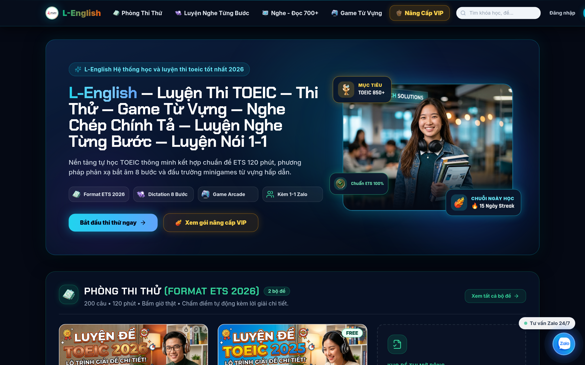

#### Toàn cảnh Landing Page (Cuộn chi tiết)
Bao gồm: Kho đề thi thử ETS 2026, Luyện nghe từng bước, Lộ trình TOEIC 700+, Trò chơi từ vựng và bảng đánh giá của học viên.

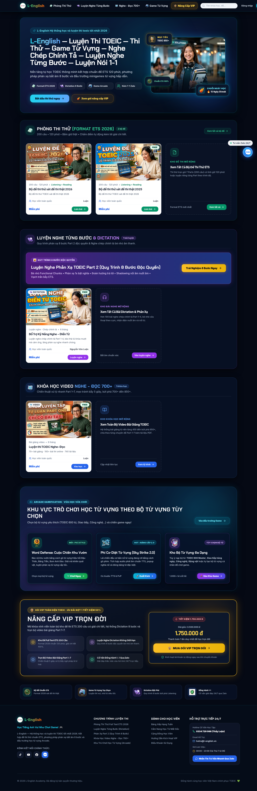

---

### 2. Trang Đăng Nhập (`/login`)
Giao diện đăng nhập thân thiện, hỗ trợ đăng nhập qua Email & Mật khẩu hoặc Đăng nhập nhanh bằng tài khoản Google, chuyển hướng thông minh về góc học tập.

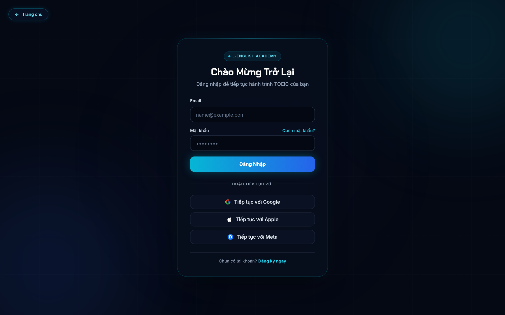

---

### 3. Trang Đăng Ký Tài Khoản (`/register`)
Form tạo tài khoản học viên mới với xác thực mật khẩu, điều khoản bảo mật và hỗ trợ đăng ký một chạm qua Google OAuth.

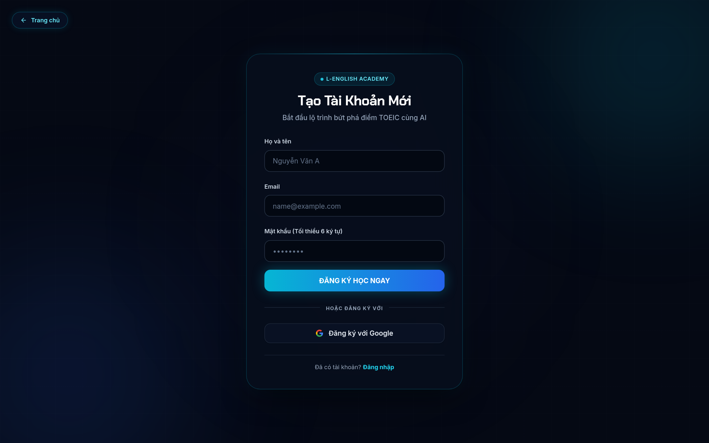

---

### 4. Trang Quên Mật Khẩu (`/forgot-password`)
Cho phép người học gửi yêu cầu khôi phục mật khẩu bảo mật qua email đã đăng ký.

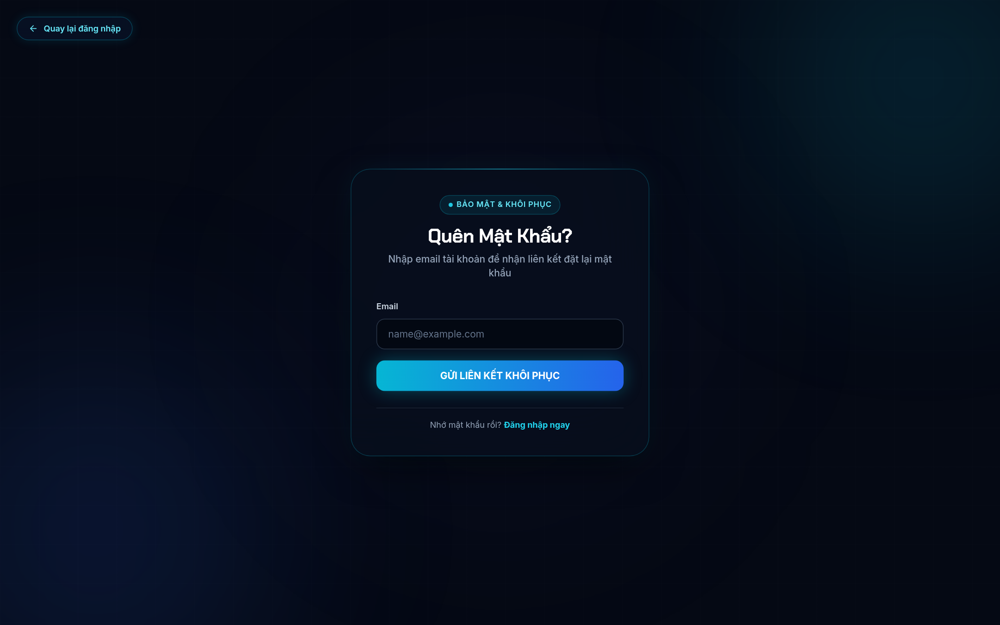

---

## PHẦN 2: KHU VỰC HỌC VIÊN CÁ NHÂN (STUDENT WORKSPACE & PORTAL)

### 5. Bàn Học Cá Nhân / Dashboard Học Viên (`/dashboard`)
Trung tâm quản lý học tập cá nhân hóa:
- **Thống kê Streak**: Chuỗi ngày học liên tục, điểm kinh nghiệm XP và cấp bậc học viên.
- **Tiếp tục bài học**: Phím tắt mở nhanh bài học hoặc đề thi đang làm dở gần nhất.
- **Nhiệm vụ hôm nay**: Daily quests nhận thưởng kinh nghiệm (Đăng nhập, làm bài nghe, học từ vựng).
- **Lịch chấm công tuần (Weekly Streak)**: Trực quan hóa mức độ chuyên cần theo từng ngày.

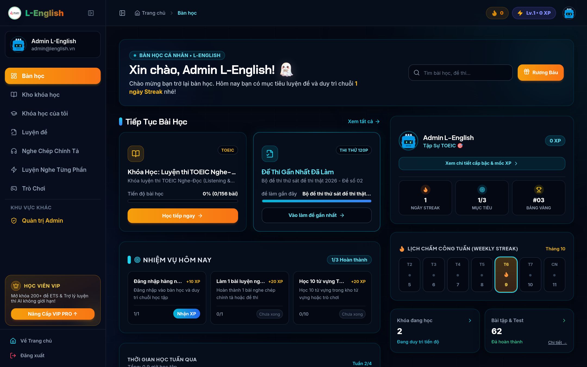

---

### 6. Khóa Học Của Tôi (`/my-courses`)
Quản lý toàn bộ lộ trình và tiến độ học tập các khóa học TOEIC mà học viên đã ghi danh kèm thanh phần trăm hoàn thành.

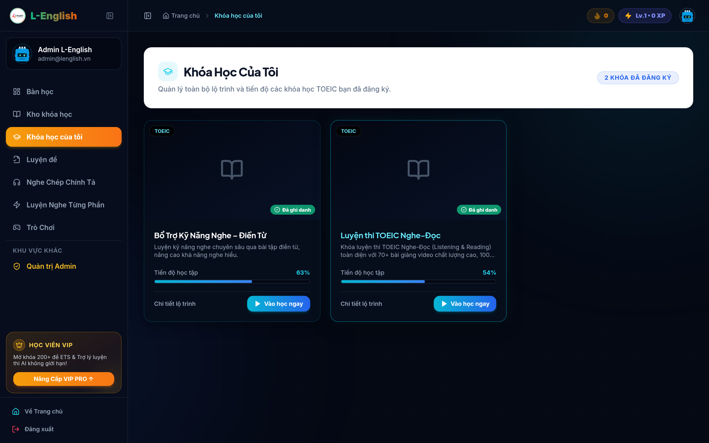

---

### 7. Kho Khóa Học & Thư Viện Bài Giảng (`/library`)
Thư viện tổng hợp toàn bộ các khóa học theo từng chuyên đề: Luyện đề sát đề thật 2026, Đề 2025, Khóa Nghe - Đọc, Khóa Bổ trợ Kỹ Năng Nghe Điền Từ.

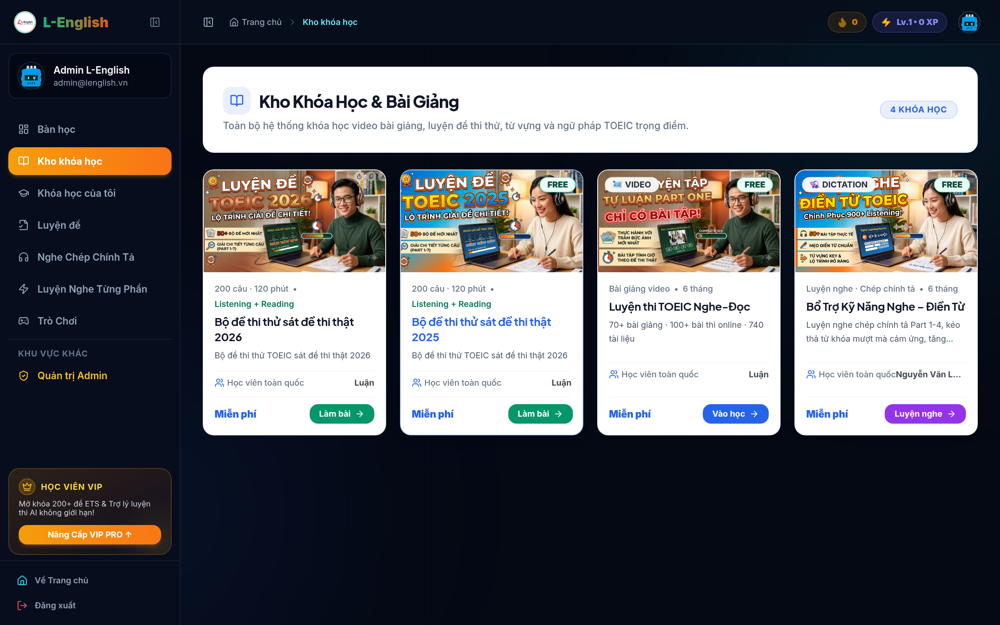

---

### 8. Hồ Sơ Cá Nhân & Bảng Thành Tích (`/profile`)
Trang thông tin học viên đầy đủ:
- **Biểu đồ đóng góp 52 tuần**: Tương tự GitHub Activity Matrix, hiển thị tần suất học tập theo thời gian thực.
- **Thống kê bài giải**: Phân tích chi tiết số lượng câu Listening và Reading đã giải cùng độ chính xác.
- **Hệ thống Huy hiệu (Badges)**: Bộ sưu tập danh hiệu như "Thánh Nghe Điền Từ", cấp bậc học tập.
- **Cài đặt tài khoản**: Tùy chỉnh thông tin cá nhân, ảnh đại diện và ảnh bìa.

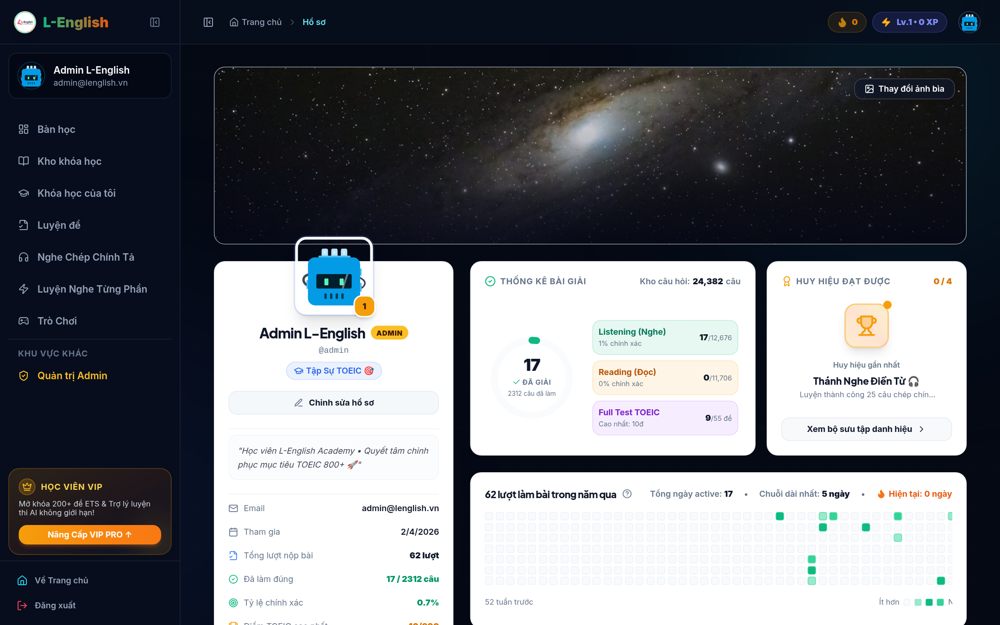

---

## PHẦN 3: HỆ THỐNG THI THỬ CHUẨN ETS (FULL TEST SYSTEM)

### 9. Kho Đề Thi Thử Full Test ETS (`/fulltests`)
Tập hợp các bộ đề thi TOEIC 200 câu Listening & Reading chuẩn format ETS từ năm 2022 đến 2026 và các đề thi phân hóa 850+.

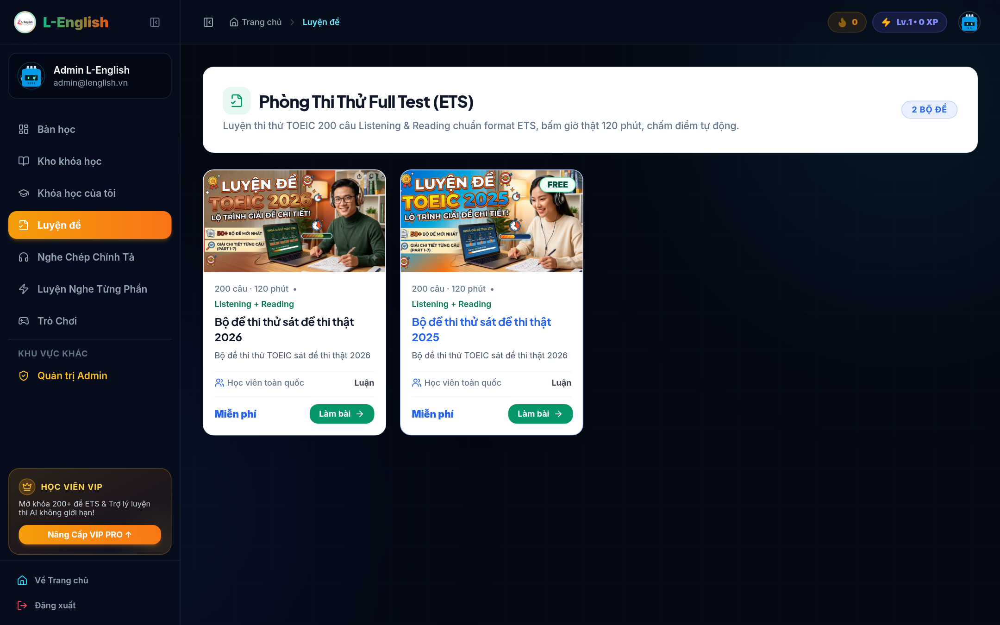

---

### 10. Danh Sách Đề Chi Tiết Trong Khóa Thi Thử (`/courses/13/fulltest`)
Hiển thị danh sách các mã đề thi cụ thể trong từng bộ đề kèm thời lượng, số câu hỏi và trạng thái đã làm / chưa làm.

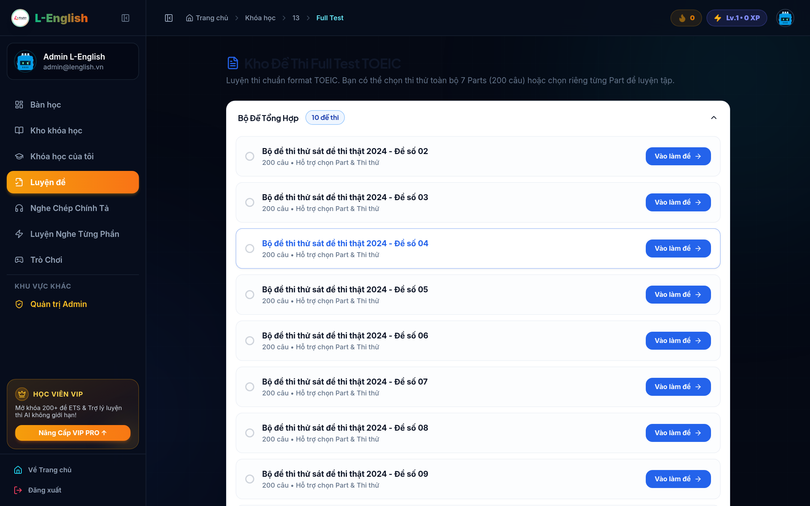

---

### 11. Cấu Hình & Tùy Chọn Phòng Thi (`/courses/13/fulltest/74`)
Giao diện trước khi bắt đầu bài thi:
- **Chế độ**: Thi thử (Exam Mode - tính giờ, nộp bài nhận điểm) hoặc Luyện tập (Practice Mode - xem giải thích tức thì).
- **Lựa chọn phần thi**: Thi toàn bộ 7 Parts hoặc thi riêng lẻ Listening (Part 1-4) / Reading (Part 5-7).
- **Tùy chỉnh thời gian**: 15 phút, 30 phút, 45 phút, 60 phút, 90 phút hoặc 120 phút đầy đủ.

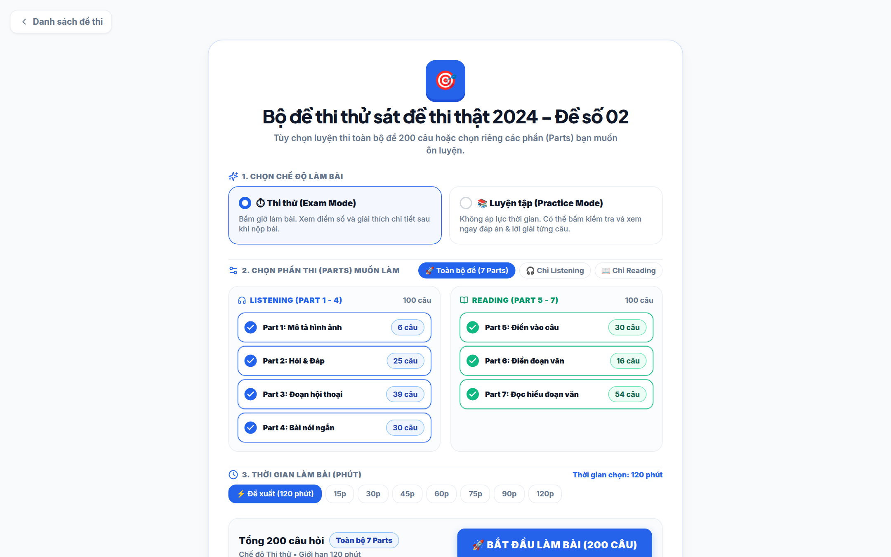

---

### 12. Kiểm Tra Thiết Bị Âm Thanh (Audio Pre-check)
Hệ thống hiển thị bước kiểm tra âm lượng tai nghe/loa trước khi vào phòng thi chính thức để đảm bảo trải nghiệm nghe tốt nhất.

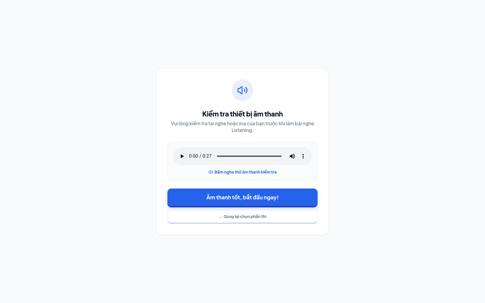

---

### 13. Phòng Thi Trực Tuyến Thời Gian Thực (Active Exam View)
Mô phỏng thực tế phòng thi TOEIC quốc tế:
- **Header điều khiển**: Đồng hồ đếm ngược 120 phút, nút tạm dừng, nút nộp bài và chỉ số % đã làm.
- **Bảng câu hỏi (Question Palette)**: Menu điều hướng nhanh 200 câu hỏi, gắn cờ đánh dấu câu phân vân, bộ lọc đã làm/chưa làm.
- **Trình phát Audio chuẩn ETS**: Tích hợp kèm hình ảnh đề thi Part 1 và các lựa chọn đáp án trắc nghiệm A-B-C-D.

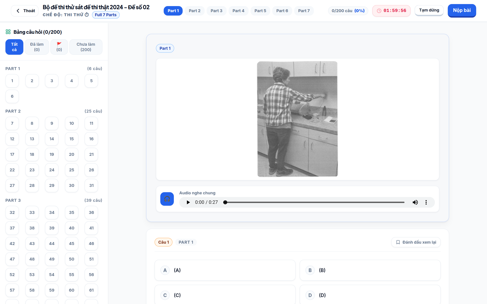

---

## PHẦN 4: CHUYÊN ĐỀ LUYỆN NGHE & PHẢN XẠ BẮT ÂM (LISTENING & PART 2 COACH)

### 14. Khu Vực Luyện Nghe Điền Từ - Dictation (`/listening`)
Chuyên mục luyện nghe chép chính tả Part 1-4, rèn luyện kỹ năng nghe bắt từ khóa và phản xạ âm thanh tức thì.

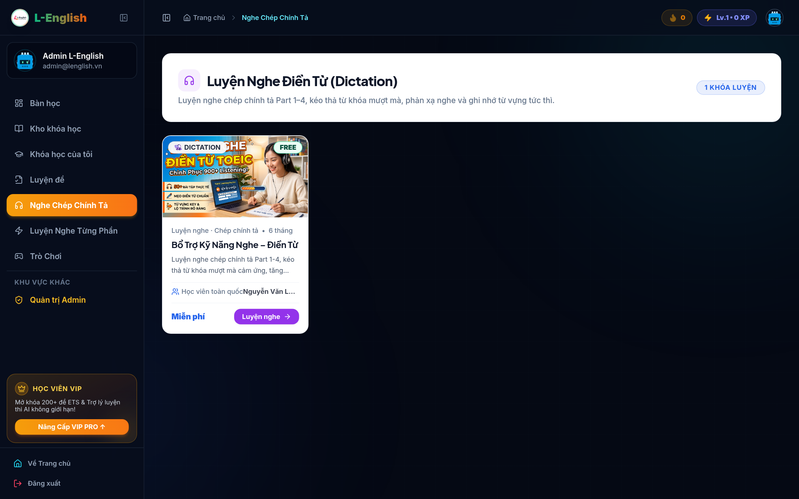

---

### 15. Huấn Luyện Phản Xạ Nghe TOEIC Part 2 - Hub Tổng Quan (`/part2-coach`)
Phương pháp độc quyền bóc tách Functional Chunks với quy trình 7 bước:
- Bộ lọc dạng câu: Wh-Questions, Yes/No, Can/Could, Lựa chọn (Or), Câu hỏi đuôi, Trần thuật.
- Danh sách 25 cụm luyện tập từ cơ bản (500+) đến nâng cao (650+).

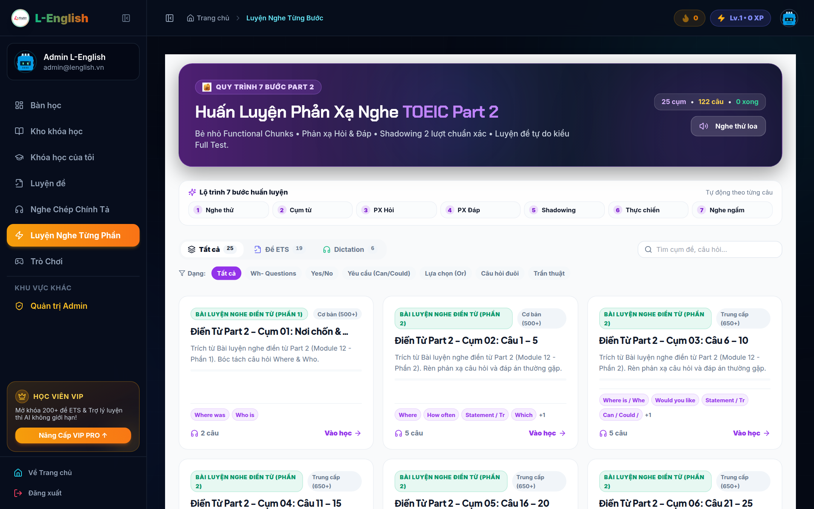

---

### 16. Trình Huấn Luyện Tương Tác 7 Bước Part 2 (`/part2-coach/dictation-part2-unit1`)
Giao diện bài luyện tập chi tiết với Stepper thanh tiến trình:
1. **Nghe thử** (Làm quen ngữ cảnh)
2. **Cụm từ** (Từ để hỏi & từ vựng)
3. **Phản xạ Hỏi** (Bật nghĩa câu hỏi)
4. **Phản xạ Đáp** (Bật câu trả lời)
5. **Shadowing** (Nhại âm chuẩn xác)
6. **Thực chiến** (Làm bài trực tiếp)
7. **Nghe ngấm** (Phát lặp thụ động)

Hỗ trợ phím tắt Space (Phát/Dừng), phím R (Nghe lại), mũi tên (Đổi câu).

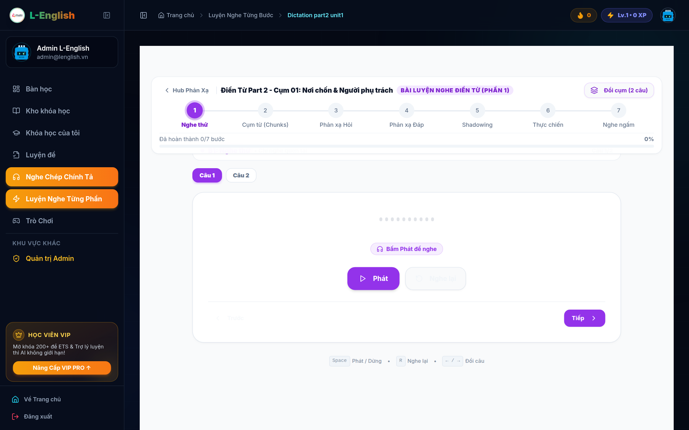

---

## PHẦN 5: KHÔNG GIAN HỌC TẬP TRỰC TUYẾN & BÀI GIẢNG (LEARNING & QUIZ)

### 17. Không Gian Học Bài Giảng & Video (`/courses/1/learn`)
Không gian học tập chuyên nghiệp:
- Cột phải hiển thị cấu trúc chương mục và danh sách 150 bài học.
- Thanh tiến độ hoàn thành khóa học.
- Khu vực video bài giảng, nút đánh dấu hoàn thành, chuyển bài và phần ghi chú cá nhân.

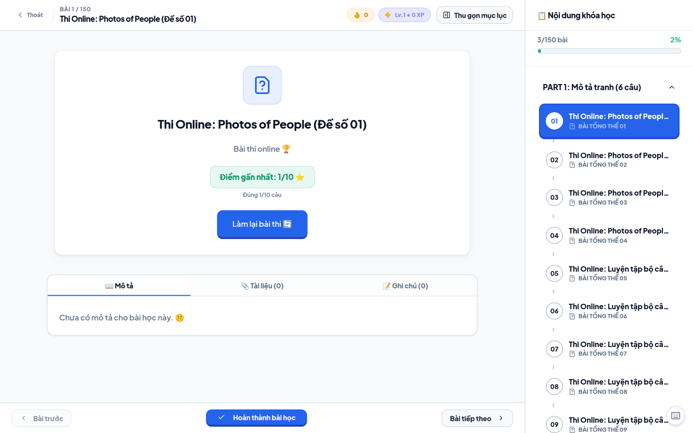

---

### 18. Giao Diện Làm Bài Thi & Trắc Nghiệm Bài Học
Giao diện trắc nghiệm trực quan tích hợp ngay trong khóa học với hình ảnh tranh Part 1, trình phát audio bài thi và danh sách câu hỏi điều hướng linh hoạt.

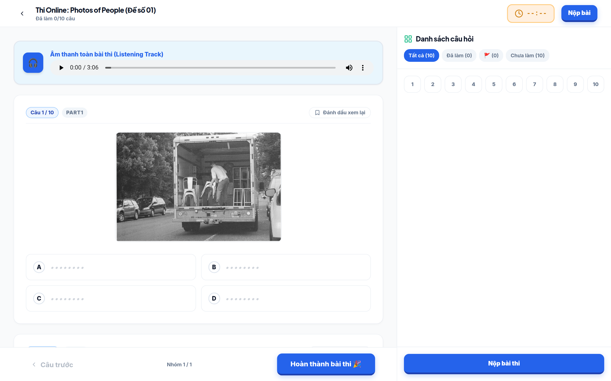

---

## PHẦN 6: ĐẤU TRƯỜNG TRÒ CHƠI ÔN TẬP TỪ VỰNG (GAMIFICATION ARCADE)

### 19. Trung Tâm Trò Chơi Ôn Tập - Games Hub (`/games`)
Hub giải trí học tập kích thích học từ vựng qua cơ chế Gamification:
- Giới thiệu các tựa game nổi bật.
- Bảng xếp hạng điểm số cao (Leaderboard).
- Thẻ tính năng và phần thưởng XP.

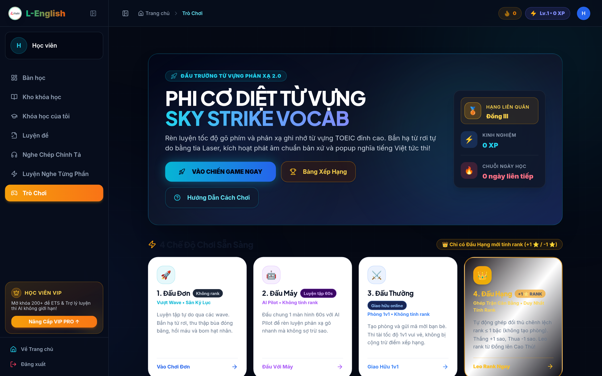

---

### 20. Trò Chơi Word Shooter (Bắn Chữ Thiên Thạch) (`/games/word-shooter`)
Mini-game gõ phím phản xạ:
- Hướng dẫn tân thủ trực quan cách bảo vệ phòng tuyến trước các thiên thạch mang từ vựng TOEIC.
- Bắn hạ từ bằng cách gõ chính xác mặt chữ tiếng Anh.

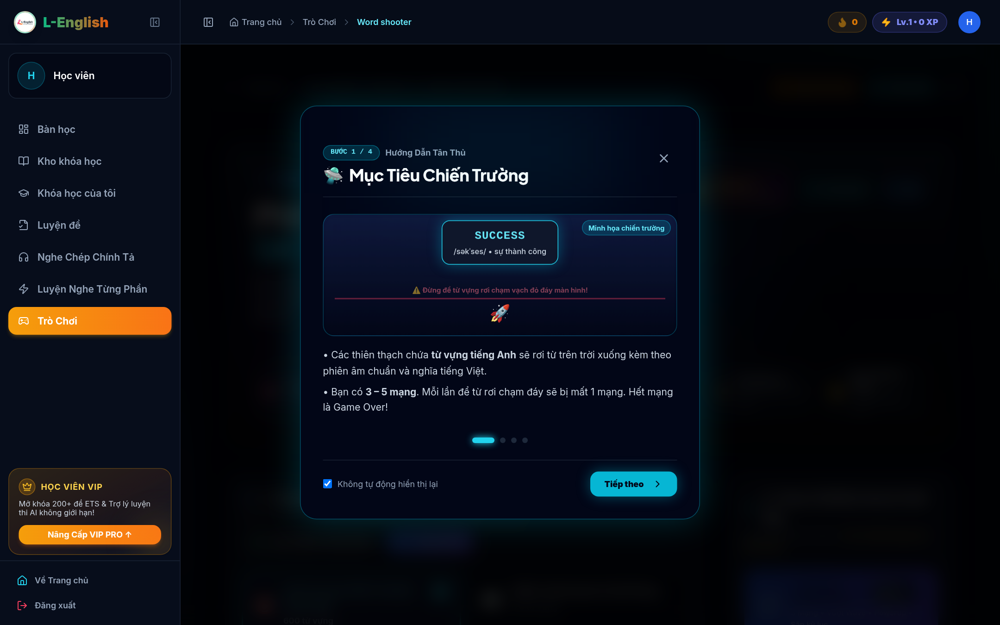

---

### 21. Trò Chơi Word Defense (Cuộc Chiến Khu Vườn Từ Vựng) (`/games/word-defense`)
Mini-game chiến thuật phong cách Plants vs. Zombies:
- Triệu hồi trụ bắn bằng từ vựng tiếng Anh trên 5 hàng ngang.
- Tùy chọn kho từ vựng chiến đấu: 600 từ TOEIC căn bản hoặc TOEIC Kinh doanh & Văn phòng.

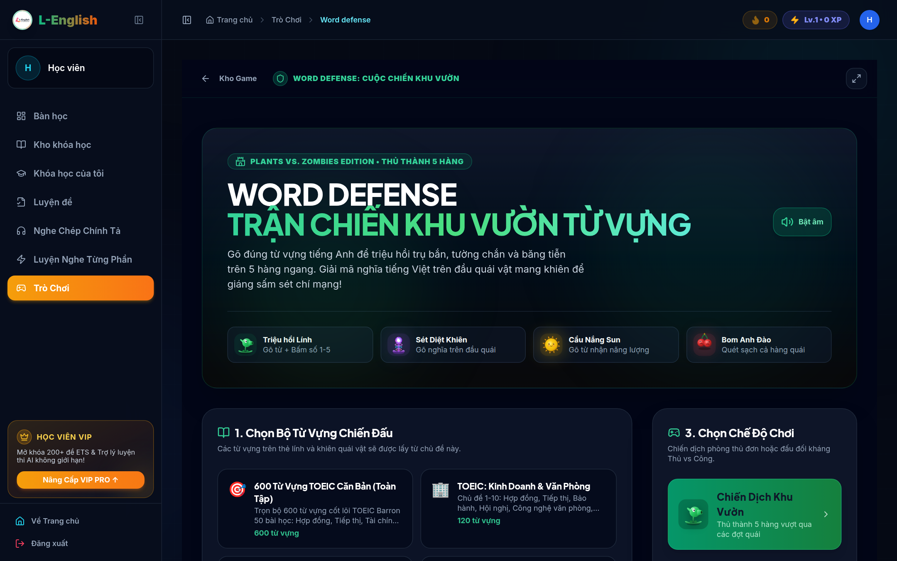

#### Màn hình chiến trường Word Defense:

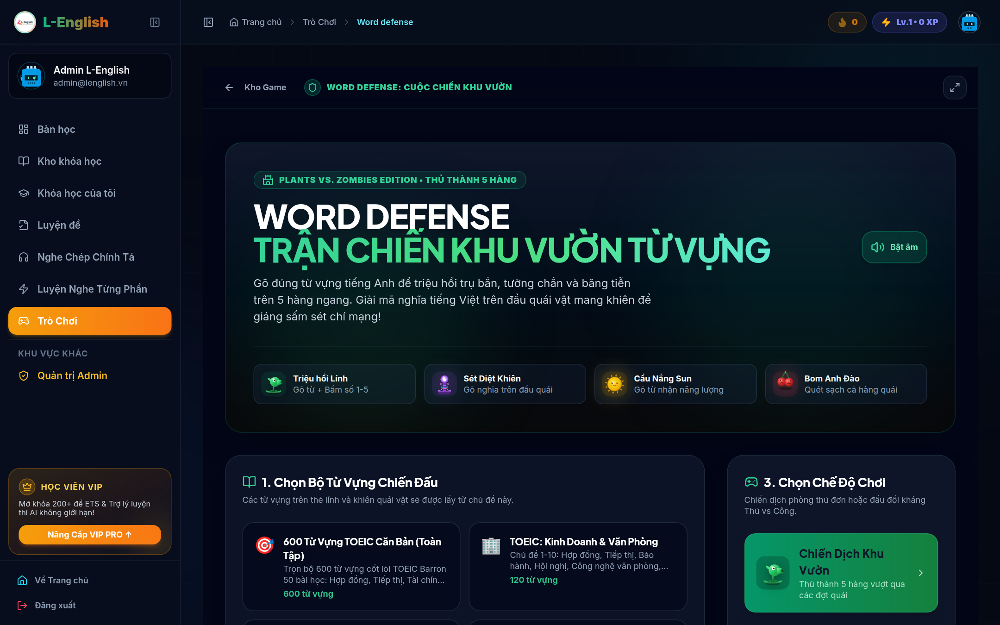

---

## PHẦN 7: GIAO DIỆN TỐI ƯU TRÊN THIẾT BỊ DI ĐỘNG (MOBILE RESPONSIVE)

### 22. Trang Chủ Mobile Responsive (Viewport 390x844)
Giao diện co giãn mượt mà trên smartphone với thanh điều hướng tối giản, phông chữ tối ưu và nút gọi hành động rõ ràng.

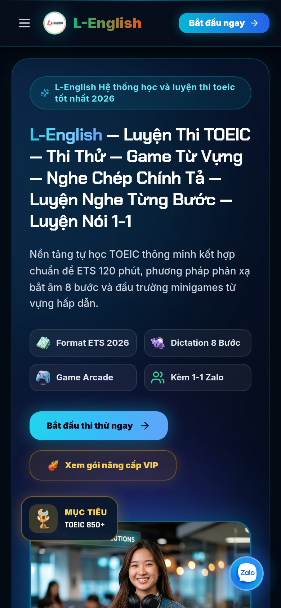

---

### 23. Games Hub Trên Di Động
Trải nghiệm chơi game và duyệt danh mục trò chơi tương thích hoàn hảo với màn hình cảm ứng di động.

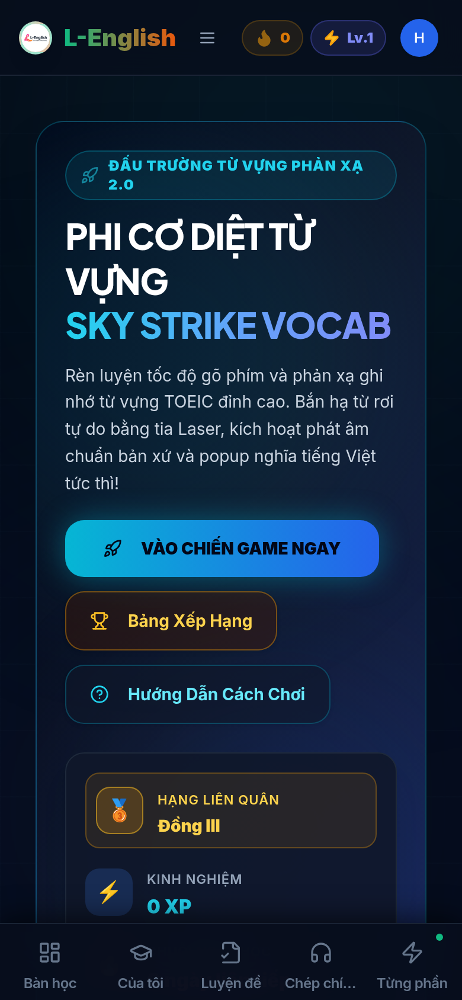

---

## BẢNG TỔNG HỢP URL & ĐƯỜNG DẪN ROUTE

| STT | Tên Màn Hình | Đường Dẫn Route | Quyền Truy Cập | Tên Tệp Ảnh Chụp |
|:---:|:---|:---|:---:|:---|
| 1 | Trang Chủ - Hero Section | `/` | Công khai | `01_trang_chu_hero.png` |
| 2 | Trang Chủ - Toàn Cảnh (Full Page) | `/` | Công khai | `02_trang_chu_toan_canh.png` |
| 3 | Trang Đăng Nhập | `/login` | Công khai | `03_trang_dang_nhap.png` |
| 4 | Trang Đăng Ký | `/register` | Công khai | `04_trang_dang_ky.png` |
| 5 | Trang Quên Mật Khẩu | `/forgot-password` | Công khai | `05_trang_quen_mat_khau.png` |
| 6 | Trung Tâm Trò Chơi (Games Hub) | `/games` | Công khai | `06_trung_tam_tro_choi.png` |
| 7 | Game Word Shooter - Hướng Dẫn | `/games/word-shooter` | Công khai | `07_game_word_shooter.png` |
| 8 | Game Word Shooter - Bàn Chơi | `/games/word-shooter` | Công khai | `07b_game_word_shooter_man_choi.png` |
| 9 | Game Word Defense - Giới Thiệu | `/games/word-defense` | Công khai | `08_game_word_defense.png` |
| 10 | Game Word Defense - Chọn Bộ Từ | `/games/word-defense` | Công khai | `08c_game_word_defense_man_choi.png` |
| 11 | Bàn Học Cá Nhân (Dashboard) | `/dashboard` | Học viên | `09_dashboard_hoc_vien.png` |
| 12 | Khóa Học Của Tôi | `/my-courses` | Học viên | `10_khoa_hoc_cua_toi.png` |
| 13 | Thư Viện Bài Giảng & Khóa Học | `/library` | Học viên | `11_thu_vien_tai_lieu.png` |
| 14 | Luyện Nghe Điền Từ (Dictation) | `/listening` | Học viên | `12_luyen_nghe_listening.png` |
| 15 | Kho Đề Thi Thử Full Tests | `/fulltests` | Học viên | `13_kho_de_fulltests.png` |
| 16 | Danh Sách Đề Thi Theo Khóa | `/courses/13/fulltest` | Học viên | `14_danh_sach_de_thi_2024.png` |
| 17 | Cấu Hình Phòng Thi Full Test | `/courses/13/fulltest/74` | Học viên | `15_phong_thi_fulltest_exam.png` |
| 18 | Kiểm Tra Âm Thanh Trước Khi Thi | `/courses/13/fulltest/74` (State) | Học viên | `15b_phong_thi_fulltest_dang_lam_bai.png` |
| 19 | Phòng Thi Full Test Đang Làm Bài | `/courses/13/fulltest/74` (Live) | Học viên | `15c_phong_thi_fulltest_dang_lam_bai_that.png` |
| 20 | Part 2 Coach - Hub Tổng Quan | `/part2-coach` | Học viên | `16_chuyen_de_part2_coach.png` |
| 21 | Part 2 Coach - Trình Luyện 7 Bước | `/part2-coach/dictation-part2-unit1` | Học viên | `16c_part2_coach_stepper_luyen_tap.png` |
| 22 | Không Gian Học Bài Giảng & Video | `/courses/1/learn` | Học viên | `17_giao_dien_hoc_bai_learn.png` |
| 23 | Làm Bài Thi Trắc Nghiệm Bài Học | `/courses/1/learn` (Quiz) | Học viên | `17b_giao_dien_lam_bai_thi_khoa_hoc.png` |
| 24 | Học Từ Vựng Flashcard | `/courses/1/vocab` | Học viên | `18_hoc_tu_vung_vocab.png` |
| 25 | Trang Cá Nhân, Thành Tích & Cài Đặt | `/profile` | Học viên | `19_trang_ca_nhan_profile.png` |
| 26 | Mobile Responsive - Trang Chủ | `/` (Mobile) | Công khai | `20_mobile_trang_chu.png` |
| 27 | Mobile Responsive - Games Hub | `/games` (Mobile) | Công khai | `21_mobile_games_hub.png` |

---

> **Lưu ý**: Tất cả các ảnh chụp gốc độ phân giải cao được lưu trữ tại thư mục:  
> **`screenshots/`** ngay trong thư mục gốc của dự án.
