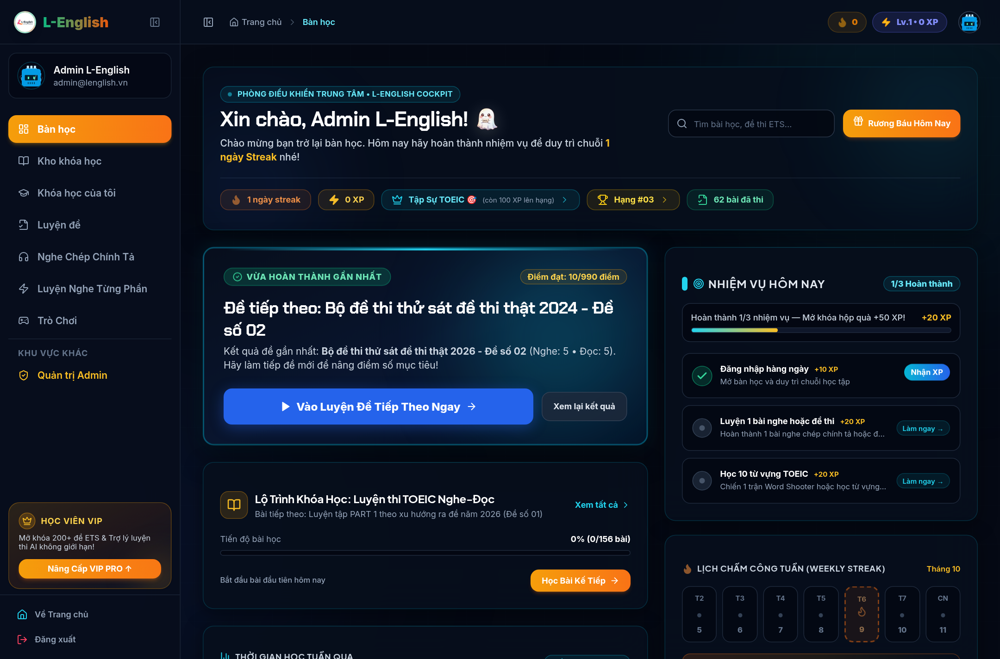
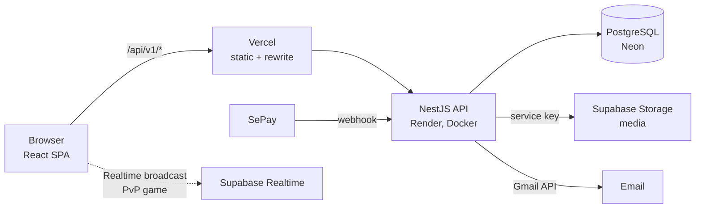

# L-English Academy

A TOEIC learning and mock-exam platform: video lessons, quizzes, full 200-question TOEIC tests with ETS score conversion, dictation, vocabulary games and VIP payments via bank transfer.

**Live:** https://luandz123-l-english-academy.vercel.app · **API docs:** Swagger at `/api/docs` on the backend

The project started as a React app calling Supabase directly from the browser. I rebuilt the data layer as a **NestJS + PostgreSQL modular monolith**, kept the UI unchanged, and cut production over in one step with the data verified by checksum.

<p align="center">
  
  
  
  
</p>

## Why the rewrite

The original app trusted the browser with everything, and Row-Level Security alone could not fix that:

| Problem in the Supabase version | Fix in the NestJS version |
|---|---|
| `answers.is_correct` readable by anyone, so every quiz answer showed up in DevTools | Student DTOs never serialize `is_correct`; grading happens on the server |
| The client computed and inserted its own score (`score: 10/10`) | `POST /quizzes/:id/submit` takes only the selected answer IDs; the server grades, converts TOEIC scores with the ETS table and saves the result in one transaction |
| The client set the price; the payment webhook matched the "latest pending order" | Price comes from server settings; the SePay webhook requires an API key (`timingSafeEqual`), the full amount and the exact order code; activation is idempotent and transactional |
| Paid lessons and media readable without enrollment | `canStudyLesson` / `canTakeQuiz` checks on every read and write route, including enrollment expiry |
| Multi-step admin imports with no transaction left half-written courses | Each import (course JSON, full-test package, quiz questions) runs in a single `$transaction` |

## Architecture



**Backend** is a modular monolith with 7 modules: `auth`, `catalog`, `learning`, `assessment`, `payments`, `admin` and `media`. Each one follows `controller → service → repository`. Modules talk to each other only through exported services, never through another module's repository.

| | |
|---|---|
| Endpoints | ~170 REST routes, all documented in Swagger, with guards declared per controller |
| Data model | 31 Prisma models; schema changes go through migrations only (no `synchronize`) |
| Validation | `class-validator` DTOs with global `whitelist` + `forbidNonWhitelisted`: a client that sends `score` or `price` gets `400` |
| Errors | One exception filter returning `{ statusCode, code, message }` |
| Config | Environment validated with `zod` at boot; production refuses to start without its required secrets |
| Auth | Own JWT access tokens + rotating refresh tokens in httpOnly cookies, `argon2` hashing, email confirmation, password reset, Google OAuth |

## Tech stack

| Layer | Tools |
|---|---|
| Frontend | React 18, TypeScript, Vite, TanStack Query, Tailwind CSS, shadcn/ui |
| Backend | NestJS 11, Prisma 7 (pg adapter), PostgreSQL 18, class-validator, Swagger, argon2 |
| Testing | Jest, Supertest, Testcontainers (a real Postgres per run), Vitest |
| Infra | Vercel, Render (Docker), Neon, Supabase Storage/Realtime, SePay, Gmail API |
| CI/CD | GitHub Actions: lint → typecheck → test → build → migrate → deploy |

## Testing

| Suite | Count |
|---|---|
| Backend unit (Jest) | 346 tests in 26 suites |
| Backend e2e (Supertest + Testcontainers Postgres 18) | 447 tests in 29 suites |
| Frontend API adapters (Vitest) | 229 tests |

Every Row-Level Security policy from the old database has a matching backend check **and** an e2e test that covers a guest (`401`), the wrong user or role (`403`/`404`) and the owner or admin (`2xx`). The e2e suite also covers answer leakage, replayed payment webhooks and rollback of a failed import.

`scripts/check-ui-diff.mjs` runs on every pull request. It fails when a `.tsx` change touches JSX, `className` or UI text outside the data-fetching code, which is how the refactor showed it left the interface unchanged.

## How the migration was run

- **Parity matrix:** 155 existing behaviors, each traced from the old `file:line` to its new endpoint, its test and its status ([docs/PARITY.md](docs/PARITY.md)).
- **Recorded decisions:** architecture decision records live in [docs/adr](docs/adr). Ambiguous legacy behavior went into [docs/OPEN_QUESTIONS.md](docs/OPEN_QUESTIONS.md) and was kept as-is unless explicitly decided otherwise.
- **Staging first:** every merge deployed automatically to a staging stack (Vercel preview → Render → Neon) and was smoke-tested there.
- **Single cutover:** test data was wiped, 15 content tables (~129k rows) were copied from Supabase and verified by row count **and** MD5 per table, then production was switched. Rollback means promoting the previous Vercel deployment ([docs/CUTOVER.md](docs/CUTOVER.md)).

## Project structure

```
backend/                 NestJS API
  src/modules/<module>/  controller, service, repository, mapper, dto
  prisma/                schema + migrations
  test/                  e2e specs (Testcontainers)
  scripts/               content copy / verify, grant-admin
src/                     React app
  lib/api/               typed API client, the only code that calls the backend
docs/                    HLD, ADRs, parity matrix, cutover runbook (Vietnamese)
.github/workflows/       CI and deploy pipelines
```

## Running locally

Requirements: Node 22 and Docker.

```bash
# 1. Infrastructure: Postgres 18, S3-compatible storage, Mailpit
docker compose up -d

# 2. Backend (http://localhost:3000, Swagger at /api/docs)
cd backend
cp .env.example .env        # fill in values; STORAGE_PROVIDER=memory works offline
npm ci
npx prisma migrate deploy
npm run start:dev

# 3. Frontend (http://localhost:8082, proxies /api/v1 to the backend)
cd ..
cp .env.example .env        # VITE_SUPABASE_* is still used for Realtime and Storage URLs
npm ci
npm run dev
```

Useful commands:

```bash
cd backend && npm test            # unit tests
cd backend && npm run test:e2e    # e2e (needs Docker for Testcontainers)
npm test                          # frontend adapter tests
npm run check:ui                  # check for UI changes against a base branch
```

## Known limitations

- Speaking rooms (`/speaking`) still use the original Supabase calls. Their tables were never deployed to the old production either, so this part of the migration was deferred.
- XP, streaks and game ranks stay client-side (`localStorage`), as in the original app.
- Media stays in Supabase Storage; uploads now go through the backend using a service key, with size and MIME limits.
