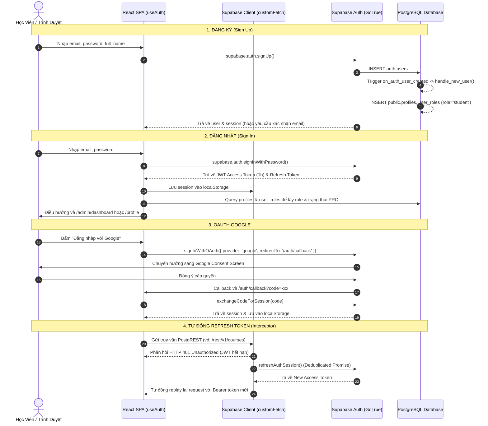
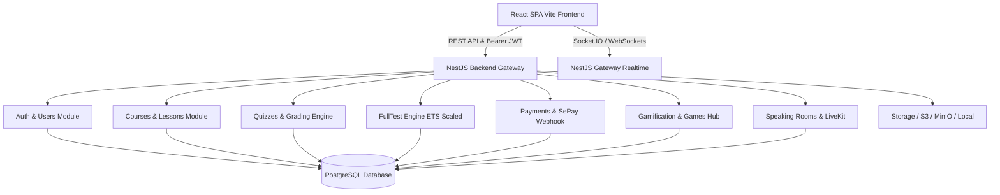

# BÁO CÁO ĐÁNH GIÁ HIỆN TRẠNG TOÀN DIỆN CODEBASE L-ENGLISH ACADEMY
> **Mục tiêu**: Chuẩn bị di chuyển (refactor) từ kiến trúc *Frontend gọi trực tiếp Supabase (BaaS)* sang kiến trúc *Backend tập trung (NestJS + React + PostgreSQL)*.  
> **Nguyên tắc báo cáo**: Bám sát mã nguồn thực tế, có đường dẫn file cụ thể, phân định rõ ràng giữa hành vi hiện tại và rủi ro/lỗ hổng bảo mật.

---

## 1. Cấu Trúc Thư Mục & Công Nghệ Đang Dùng

### 1.1. Công nghệ & Thư viện chính (Trích xuất từ [package.json](../package.json))

| Hạng mục | Công nghệ / Thư viện | Version | Ghi chú & Vai trò |
| :--- | :--- | :--- | :--- |
| **Runtime & Bundler** | Vite | `^5.4.19` | Build tool và Dev Server chạy tại cổng `8082` |
| **Core UI Framework** | React / React DOM | `^18.3.1` | UI Library |
| **Ngôn ngữ** | TypeScript | `^5.8.3` | Type checking tĩnh |
| **Routing** | react-router-dom | `^6.30.1` | Điều hướng Single Page Application (SPA) |
| **State & Server Cache** | @tanstack/react-query | `^5.83.0` | Cache query, mutation, retry, staleTime 5 phút |
| **Supabase SDK** | @supabase/supabase-js | `^2.100.1` | Client PostgREST, Auth, Realtime, Storage |
| **Voice / WebRTC** | livekit-client / livekit-server-sdk | `^2.23.0` / `^2.19.2` | Phòng đàm thoại tiếng Anh LiveKit SFU |
| **Styling** | TailwindCSS + PostCSS + Autoprefixer | `^3.4.17` | CSS utility-first + design tokens HSL |
| **UI Components** | Radix UI + shadcn/ui primitives | `^1.x` - `^2.x` | Dialog, Dropdown, Accordion, Tooltip, Toast... |
| **Form & Validation** | react-hook-form + zod | `^7.61.1` + `^3.25.76` | Quản lý form và schema validation |
| **Biểu đồ** | recharts | `^2.15.4` | Thống kê kết quả thi, tiến độ học tập |
| **Drag & Drop** | @dnd-kit/core, sortable, utilities | `^6.3.1`, `^10.0.0` | Sắp xếp câu hỏi / kéo thả Part 2 |
| **Icons & Typography** | lucide-react, @tailwindcss/typography | `^0.462.0` | Bộ icon SVG |
| **Testing** | Vitest (`^3.2.4`) + Playwright (`^1.57.0`) | Unit test & E2E browser test |

### 1.2. Cấu trúc cây thư mục Workspace

```
c:\Users\lenovo\l-english-academy\
├── api/                           # Vercel Serverless Edge Functions (Node/Edge runtime)
│   ├── check-payment.ts           # Tra cứu trạng thái đơn thanh toán
│   ├── payment-webhook.ts         # Webhook nhận biến động SePay 24/7
│   ├── simulate-payment.ts        # Giả lập thanh toán test đơn
│   ├── speaking-token.ts          # Cấp JWT LiveKit / ICE Servers STUN cho WebRTC
│   └── tts.ts                     # Proxy Google Translate TTS sang MP3
├── public/                        # Static assets (audio, favicon, robots.txt)
├── src/
│   ├── assets/                    # 3D icons, illustrations (.webp, .png, .svg)
│   ├── components/                # UI components tái sử dụng
│   │   ├── admin/                 # Modal & form quản lý (QuizManager, LessonManager...)
│   │   ├── audio/                 # Audio player thanh tiến trình tùy biến
│   │   ├── auth/                  # Password strength indicator
│   │   ├── game/                  # Arena, Lobby, Canvas cho Word Shooter & Defense
│   │   ├── landing/               # Hero, Courses, Testimonials, FAQ cho Homepage
│   │   ├── part2/                 # Luyện nghe phản xạ Part 2
│   │   ├── speaking/              # Giao diện thẻ thành viên & phòng đàm thoại
│   │   └── ui/                    # shadcn UI primitives (button, dialog, input...)
│   ├── data/                      # Dữ liệu tĩnh kích thước lớn nhúng trong bundle (part2CoachData, toeic600Data)
│   ├── hooks/                     # Custom React hooks (useAuth, useGamification, useVoiceRoom...)
│   ├── integrations/
│   │   ├── lovable/               # Lovable auth integration
│   │   └── supabase/              # Supabase Client + types.ts tự động sinh từ PostgreSQL
│   ├── lib/                       # Utility helpers (errorHandler, googleOAuth, lazyWithRetry...)
│   ├── pages/                     # 27 trang học viên & trang công khai
│   │   └── admin/                 # 17 trang quản trị viên
│   ├── services/                  # Business services (speakingService, homepageShowcaseService...)
│   ├── types/                     # TypeScript definitions (speaking, part2Coach...)
│   ├── utils/                     # Format audio URL helper
│   ├── App.tsx                    # Định tuyến toàn app (Routes, Providers, Global Audio Lock)
│   ├── index.css                  # CSS Variables & theme tokens
│   └── main.tsx                   # React root entry
├── supabase/
│   ├── functions/                 # Supabase Deno Edge Functions
│   │   ├── create-test-accounts/  # Script tạo tài khoản test (admin/student)
│   │   └── manage-students/       # Script admin tạo user qua auth.admin API
│   ├── migrations/                # 17 tệp SQL migrations quản lý schema, trigger, RLS
│   └── seed_toeic_course.sql      # Seed mẫu 7 Parts TOEIC
├── vercel.json                    # Cấu hình routing rewrites cho Vercel
└── vite.config.ts                 # Cấu hình Vite & plugin tts-proxy-middleware
```

---

## 2. Danh Sách Toàn Bộ Route/Trang Và Chức Năng Của Từng Trang

Được cấu hình tập trung tại [src/App.tsx](../src/App.tsx).

### 2.1. Nhóm Trang Công Khai (Public Routes)

| Đường dẫn (URL) | Component file | Chức năng chính |
| :--- | :--- | :--- |
| `/` | [Index.tsx](../src/pages/Index.tsx) | Trang chủ landing page giới thiệu học viện, banner khóa học, danh mục, bảng so sánh gói VIP, feedback học viên, FAQ, tích hợp modal thanh toán. |
| `/login` | [Login.tsx](../src/pages/Login.tsx) | Đăng nhập tài khoản bằng Email/Password hoặc Google OAuth; hỗ trợ lưu redirect URL. |
| `/register` | [Register.tsx](../src/pages/Register.tsx) | Đăng ký tài khoản học viên mới; kiểm tra mật khẩu đạt chuẩn bảo mật 8 ký tự; hỗ trợ Google Sign Up. |
| `/forgot-password` | [ForgotPassword.tsx](../src/pages/ForgotPassword.tsx) | Gửi email liên kết khôi phục mật khẩu. |
| `/reset-password` | [ResetPassword.tsx](../src/pages/ResetPassword.tsx) | Nhập mật khẩu mới sau khi xác thực token từ email. |
| `/auth/callback` | [AuthCallback.tsx](../src/pages/AuthCallback.tsx) | Đón nhận OAuth redirect từ Google, trao đổi PKCE authorization code lấy Session. |
| `/games` | [GamesHub.tsx](../src/pages/GamesHub.tsx) | Sảnh trò chơi học từ vựng (Word Defense, Word Shooter), BXH mùa giải, shop bộ từ vựng. |
| `/games/word-shooter` | [WordShooterGame.tsx](../src/pages/WordShooterGame.tsx) | Game bắn tàu vũ trụ luyện gõ từ vựng tiếng Anh (hỗ trợ solo & thi đấu PvP thời gian thực). |
| `/games/word-defense` | [WordDefenseGame.tsx](../src/pages/WordDefenseGame.tsx) | Game thủ thành luyện từ vựng phong cách Plants vs Zombies. |
| `*` | [NotFound.tsx](../src/pages/NotFound.tsx) | Trang 404 tùy biến giao diện neon galaxy. |

### 2.2. Nhóm Trang Học Viên (Protected - Yêu cầu đăng nhập)

| Đường dẫn (URL) | Component file | Chức năng chính |
| :--- | :--- | :--- |
| `/dashboard` | [DashboardPage.tsx](../src/pages/DashboardPage.tsx) | Trung tâm học tập: khóa học đang học, tiến độ hoàn thành, nhiệm vụ hàng ngày, rương báu, streak. |
| `/profile` | [Profile.tsx](../src/pages/Profile.tsx) | Xem và chỉnh sửa thông tin cá nhân, cập nhật avatar, đổi mật khẩu, xem thống kê làm bài & trạng thái VIP. |
| `/my-courses` | [MyCoursesPage.tsx](../src/pages/MyCoursesPage.tsx) | Danh sách khóa học học viên đã đăng ký hoặc đã kích hoạt. |
| `/courses/:courseId/learn` | [LearnPage.tsx](../src/pages/LearnPage.tsx) | Không gian xem video bài giảng, popup bài tập ngắt quãng (timed practice), ghi chú cá nhân, tài liệu đính kèm. |
| `/courses/:courseId/quiz/:quizId` | [QuizPage.tsx](../src/pages/QuizPage.tsx) | Làm bài tập trắc nghiệm theo bài học, đếm ngược thời gian, lưu nháp câu trả lời. |
| `/courses/:courseId/quiz/:quizId/result` | [QuizResult.tsx](../src/pages/QuizResult.tsx) | Xem điểm số, số câu đúng/sai, giải thích chi tiết từng câu và audio nghe lại. |
| `/courses/:courseId/vocab` | [VocabPage.tsx](../src/pages/VocabPage.tsx) | Danh sách chủ đề từ vựng của khóa flashcard. |
| `/courses/:courseId/vocab-lesson/:lessonId` | [VocabLessonPage.tsx](../src/pages/VocabLessonPage.tsx) | Học từ vựng flashcard tương tác lật thẻ, nghe phát âm giọng nam/nữ, ví dụ câu, làm quiz từ vựng. |
| `/courses/:courseId/dictation/:quizId` | [DictationPage.tsx](../src/pages/DictationPage.tsx) | Luyện nghe chép chính tả (Dictation) tương tác cao với waveform audio, phân tích lỗi sai từng ký tự/từ. |
| `/part2-coach` | [Part2CoachPage.tsx](../src/pages/Part2CoachPage.tsx) | Huấn luyện viên luyện nghe phản xạ Part 2 TOEIC theo cụm bẫy (Wh-questions, Yes/No, tag question...). |
| `/courses/:courseId/fulltest` | [FullTestList.tsx](../src/pages/FullTestList.tsx) | Danh sách đề Full Test trong khóa học. |
| `/courses/:courseId/fulltest/:testId` | [FullTestExam.tsx](../src/pages/FullTestExam.tsx) | Phòng thi thử TOEIC 200 câu chuẩn ETS: chế độ thi thật (2 tiếng) hoặc luyện tập từng Part. |
| `/courses/:courseId/fulltest/:testId/result` | [FullTestResult.tsx](../src/pages/FullTestResult.tsx) | Bảng điểm TOEIC chi tiết (Listening/Reading quy đổi thang 990), phân tích điểm yếu từng Part. |
| `/fulltests` | [FullTestsPage.tsx](../src/pages/FullTestsPage.tsx) | Kho đề thi Full Test tổng hợp. |
| `/listening` | [ListeningPage.tsx](../src/pages/ListeningPage.tsx) | Kho bài học luyện nghe chọn lọc. |
| `/library` | [LibraryPage.tsx](../src/pages/LibraryPage.tsx) | Kho tài liệu PDF, audio bổ trợ. |
| `/speaking` | [SpeakingRoomsPage.tsx](../src/pages/SpeakingRoomsPage.tsx) | Sảnh phòng đàm thoại tiếng Anh: ghép phòng ngẫu nhiên theo trình độ (A1-C2), tạo phòng riêng với mật mã, trò chuyện giọng nói qua WebRTC/LiveKit. |

### 2.3. Nhóm Trang Quản Trị (Admin Routes - Yêu cầu role `admin`)

Được bảo vệ bởi [src/components/AdminRoute.tsx](../src/components/AdminRoute.tsx).

| Đường dẫn (URL) | Component file | Chức năng chính |
| :--- | :--- | :--- |
| `/admin/dashboard` | [AdminDashboard.tsx](../src/pages/admin/AdminDashboard.tsx) | Bảng điều khiển tổng quan: thống kê học viên, doanh thu, đơn hàng, biểu đồ học tập. |
| `/admin/courses` | [AdminCourses.tsx](../src/pages/admin/AdminCourses.tsx) | Quản lý danh sách khóa học (bật/tắt hiển thị, xóa, lọc theo thể loại). |
| `/admin/courses/new` | [AdminCourseNew.tsx](../src/pages/admin/AdminCourseNew.tsx) | Tạo khóa học mới, upload ảnh thumbnail. |
| `/admin/courses/:courseId` | [AdminCourseDetail.tsx](../src/pages/admin/AdminCourseDetail.tsx) | Chi tiết khóa học: quản lý cấu trúc cây Module (Part) -> Lesson -> Quiz. |
| `/admin/categories` | [AdminCategories.tsx](../src/pages/admin/AdminCategories.tsx) | Quản lý danh mục khóa học (TOEIC, Cấp 3, Tiếng Anh Căn Bản). |
| `/admin/fulltests` | [AdminFullTestManager.tsx](../src/pages/admin/AdminFullTestManager.tsx) | Quản lý ngân hàng đề thi Full Test 200 câu, audio bài thi, import đề ETS. |
| `/admin/fulltests/:testId/questions` | [AdminFullTestQuestions.tsx](../src/pages/admin/AdminFullTestQuestions.tsx) | Soạn thảo 200 câu hỏi đề thi thử, upload audio, ảnh passage, dịch nghĩa, lời giải thích. |
| `/admin/import-json` | [AdminCourseJsonImport.tsx](../src/pages/admin/AdminCourseJsonImport.tsx) | Nhập tự động toàn bộ khóa học từ file JSON (tự tải và đẩy audio/image lên Supabase Storage). |
| `/admin/students` | [AdminStudents.tsx](../src/pages/admin/AdminStudents.tsx) | Danh sách học viên, tìm kiếm theo email/tên, xem trạng thái VIP PRO. |
| `/admin/students/:userId` | [AdminStudentDetail.tsx](../src/pages/admin/AdminStudentDetail.tsx) | Chi tiết học viên: lịch sử làm bài, các khóa học đã ghi danh, ghi chú quản trị viên. |
| `/admin/enrollments` | [AdminEnrollments.tsx](../src/pages/admin/AdminEnrollments.tsx) | Quản lý đơn thanh toán SePay, danh sách ghi danh khóa học, kích hoạt PRO thủ công. |
| `/admin/materials` | [AdminMaterials.tsx](../src/pages/admin/AdminMaterials.tsx) | Quản lý kho tài nguyên học liệu (PDF, MP3) theo cây thư mục. |
| `/admin/games` | [AdminGamesConfig.tsx](../src/pages/admin/AdminGamesConfig.tsx) | Cấu hình bật/tắt trò chơi trên Arcade Hub, chọn preset 3D avatar, đổi màu theme. |
| `/admin/vocab-packs` | [AdminVocabPacks.tsx](../src/pages/admin/AdminVocabPacks.tsx) | Quản lý các bộ từ vựng dùng cho trò chơi (nhập từ vựng, cấp độ, audio). |
| `/admin/reports` | [AdminReports.tsx](../src/pages/admin/AdminReports.tsx) | Báo cáo chi tiết hoạt động học tập, tỷ lệ đỗ đề thi, điểm trung bình. |
| `/admin/backup` | [AdminBackup.tsx](../src/pages/admin/AdminBackup.tsx) | Thống kê số lượng bản ghi của 10 bảng cốt lõi, xuất dữ liệu JSON/CSV từ trình duyệt. |
| `/admin/settings` | [AdminSettings.tsx](../src/pages/admin/AdminSettings.tsx) | Cấu hình cổng thanh toán SePay/VietQR (STK ngân hàng, giá VIP), cài đặt nội dung Homepage Showcase. |

---

## 3. Bản Đồ Chi Tiết Toàn Bộ Nơi Frontend Gọi Supabase

Dưới đây là bảng tổng hợp tất cả các thao tác tương tác cơ sở dữ liệu và hạ tầng Supabase trực tiếp từ Client:

### 3.1. Thao tác trên các Bảng (PostgREST Table Queries)

| Bảng cơ sở dữ liệu | File nguồn gọi trực tiếp | Thao tác | Mô tả nghiệp vụ |
| :--- | :--- | :--- | :--- |
| `profiles` | [useAuth.tsx](../src/hooks/useAuth.tsx#L101)<br>[Profile.tsx](../src/pages/Profile.tsx#L585)<br>[Register.tsx](../src/pages/Register.tsx#L64)<br>[speakingService.ts](../src/services/speakingService.ts#L91)<br>[AdminStudents.tsx](../src/pages/admin/AdminStudents.tsx#L38) | `SELECT`, `INSERT`, `UPDATE`, `UPSERT` | Đọc thông tin học viên, họ tên, avatar, trạng thái `is_pro`, cập nhật profile cá nhân, danh sách học viên cho admin. |
| `user_roles` | [useAuth.tsx](../src/hooks/useAuth.tsx#L106)<br>[Login.tsx](../src/pages/Login.tsx#L81)<br>[AuthCallback.tsx](../src/pages/AuthCallback.tsx#L44)<br>[AdminStudents.tsx](../src/pages/admin/AdminStudents.tsx#L45) | `SELECT` | Kiểm tra quyền `role = 'admin'` để bảo vệ các tuyến `/admin/*`. |
| `courses` | [App.tsx](../src/App.tsx#L38)<br>[LearnPage.tsx](../src/pages/LearnPage.tsx#L43)<br>[AdminCourses.tsx](../src/pages/admin/AdminCourses.tsx#L33)<br>[AdminCourseNew.tsx](../src/pages/admin/AdminCourseNew.tsx#L80)<br>[AdminCourseDetail.tsx](../src/pages/admin/AdminCourseDetail.tsx#L46) | `SELECT`, `INSERT`, `UPDATE`, `DELETE` | Đọc danh sách khóa học, hiển thị thông tin khóa học, CRUD khóa học từ trang quản trị. |
| `course_categories` | [AdminCategories.tsx](../src/pages/admin/AdminCategories.tsx#L37)<br>[AdminCourseNew.tsx](../src/pages/admin/AdminCourseNew.tsx#L45) | `SELECT`, `INSERT`, `UPDATE`, `DELETE` | Đọc và quản lý danh mục phân loại khóa học. |
| `modules` | [LearnPage.tsx](../src/pages/LearnPage.tsx#L51)<br>[MyCoursesPage.tsx](../src/pages/MyCoursesPage.tsx#L106)<br>[AdminCourseDetail.tsx](../src/pages/admin/AdminCourseDetail.tsx#L55) | `SELECT`, `INSERT`, `UPDATE`, `DELETE` | Quản lý các chương học (Part 1 - Part 7) theo khóa học. |
| `lessons` | [LearnPage.tsx](../src/pages/LearnPage.tsx#L52)<br>[VocabLessonPage.tsx](../src/pages/VocabLessonPage.tsx#L64)<br>[LessonManager.tsx](../src/components/admin/LessonManager.tsx#L70) | `SELECT`, `INSERT`, `UPDATE`, `DELETE` | Đọc danh sách bài giảng, video url, PDF đính kèm, CRUD bài học. |
| `lesson_practices` | [LearnPage.tsx](../src/pages/LearnPage.tsx#L131)<br>[LessonManager.tsx](../src/components/admin/LessonManager.tsx#L245) | `SELECT`, `INSERT`, `DELETE` | Quản lý bài tập popup chèn vào thời điểm `trigger_at_seconds` trong video. |
| `quizzes` | [QuizPage.tsx](../src/pages/QuizPage.tsx#L207)<br>[QuizResult.tsx](../src/pages/QuizResult.tsx#L65)<br>[QuizManager.tsx](../src/components/admin/QuizManager.tsx#L85) | `SELECT`, `INSERT`, `UPDATE`, `DELETE` | Quản lý thông tin bài tập trắc nghiệm, thời gian làm bài, audio chung. |
| `questions` | [QuizPage.tsx](../src/pages/QuizPage.tsx#L220)<br>[QuizResult.tsx](../src/pages/QuizResult.tsx#L47)<br>[DictationPage.tsx](../src/pages/DictationPage.tsx#L330)<br>[AdminFullTestQuestions.tsx](../src/pages/admin/AdminFullTestQuestions.tsx#L145) | `SELECT`, `INSERT`, `UPDATE`, `DELETE` | Đọc và lưu trữ câu hỏi, passage text, transcript, audio/image URL, giải thích. |
| `answers` | [QuizPage.tsx](../src/pages/QuizPage.tsx#L221)<br>[QuizManager.tsx](../src/components/admin/QuizManager.tsx#L440)<br>[AdminFullTestQuestions.tsx](../src/pages/admin/AdminFullTestQuestions.tsx#L475) | `SELECT`, `INSERT`, `UPDATE`, `DELETE` | Đọc các lựa chọn đáp án A, B, C, D (kèm `is_correct`), thêm/sửa đáp án từ trang Admin. |
| `materials` | [LearnPage.tsx](../src/pages/LearnPage.tsx#L118)<br>[AdminMaterials.tsx](../src/pages/admin/AdminMaterials.tsx#L70) | `SELECT`, `INSERT`, `UPDATE`, `DELETE` | Đọc và quản lý tài liệu học tập PDF/audio đính kèm khóa học/bài học. |
| `enrollments` | [LearnPage.tsx](../src/pages/LearnPage.tsx#L34)<br>[MyCoursesPage.tsx](../src/pages/MyCoursesPage.tsx#L75)<br>[AdminEnrollments.tsx](../src/pages/admin/AdminEnrollments.tsx#L50) | `SELECT`, `INSERT`, `DELETE` | Kiểm tra quyền truy cập khóa học của học viên, quản lý danh sách ghi danh từ Admin. |
| `user_lesson_progress` | [LearnPage.tsx](../src/pages/LearnPage.tsx#L73)<br>[DashboardPage.tsx](../src/pages/DashboardPage.tsx#L155) | `SELECT`, `INSERT`, `UPDATE` | Lưu trạng thái bài học đã hoàn thành (`is_completed`), thời lượng đã xem video. |
| `user_quiz_results` | [QuizPage.tsx](../src/pages/QuizPage.tsx#L305)<br>[QuizResult.tsx](../src/pages/QuizResult.tsx#L84)<br>[DashboardPage.tsx](../src/pages/DashboardPage.tsx#L170) | `SELECT`, `INSERT` | Lưu và hiển thị kết quả làm bài tập trắc nghiệm (điểm, thời gian làm, số câu đúng). |
| `user_answers` | [QuizPage.tsx](../src/pages/QuizPage.tsx#L321)<br>[QuizResult.tsx](../src/pages/QuizResult.tsx#L111) | `SELECT`, `INSERT` | Lưu và hiển thị chi tiết câu trả lời học viên đã chọn cho từng câu hỏi trong quiz. |
| `vocab_categories` | [VocabPage.tsx](../src/pages/VocabPage.tsx#L28) | `SELECT` | Đọc danh mục từ vựng khóa Flashcard. |
| `vocab_quizzes` | [VocabPage.tsx](../src/pages/VocabPage.tsx#L41)<br>[VocabLessonPage.tsx](../src/pages/VocabLessonPage.tsx#L48) | `SELECT` | Đọc các bộ từ vựng (Day 1, Day 2...) theo danh mục. |
| `vocab_questions` | [VocabPage.tsx](../src/pages/VocabPage.tsx#L55)<br>[VocabLessonPage.tsx](../src/pages/VocabLessonPage.tsx#L81) | `SELECT` | Đọc chi tiết từ vựng (từ, phiên âm, định nghĩa Anh/Việt, ví dụ, audio nam/nữ). |
| `full_tests` | [App.tsx](../src/App.tsx#L67)<br>[FullTestExam.tsx](../src/pages/FullTestExam.tsx#L313)<br>[FullTestList.tsx](../src/pages/FullTestList.tsx#L35)<br>[AdminFullTestManager.tsx](../src/pages/admin/AdminFullTestManager.tsx#L115) | `SELECT`, `INSERT`, `UPDATE`, `DELETE` | Đọc danh sách đề thi Full Test, audio full đề, tạo và quản lý đề thi ETS. |
| `full_test_sections` | [FullTestExam.tsx](../src/pages/FullTestExam.tsx#L320)<br>[AdminFullTestQuestions.tsx](../src/pages/admin/AdminFullTestQuestions.tsx#L125) | `SELECT`, `INSERT`, `DELETE` | Liên kết đề Full Test với 7 phần thi (Part 1 - Part 7). |
| `user_full_test_results` | [FullTestExam.tsx](../src/pages/FullTestExam.tsx#L756)<br>[FullTestResult.tsx](../src/pages/FullTestResult.tsx#L90)<br>[Profile.tsx](../src/pages/Profile.tsx#L240) | `SELECT`, `INSERT` | Lưu và hiển thị kết quả thi thử TOEIC (điểm Listening, Reading, tổng điểm, answers_detail). |
| `full_test_answer_details`| [FullTestExam.tsx](../src/pages/FullTestExam.tsx#L785)<br>[FullTestResult.tsx](../src/pages/FullTestResult.tsx#L130) | `SELECT`, `INSERT` | Lưu và hiển thị chi tiết câu trả lời của 200 câu thi TOEIC (part, đáp án chọn, đúng/sai). |
| `user_notes` | [LearnPage.tsx](../src/pages/LearnPage.tsx#L109) | `SELECT`, `INSERT`, `DELETE` | Học viên ghi chú cá nhân dưới từng bài giảng video. |
| `user_favorites` | [LearnPage.tsx](../src/pages/LearnPage.tsx#L83) | `SELECT`, `INSERT`, `DELETE` | Đánh dấu bài học yêu thích. |
| `admin_student_notes` | [AdminStudentDetail.tsx](../src/pages/admin/AdminStudentDetail.tsx#L80) | `SELECT`, `INSERT`, `DELETE` | Quản trị viên ghi chú về tình hình học tập của học viên. |
| `admin_activity_log` | [AdminDashboard.tsx](../src/pages/admin/AdminDashboard.tsx#L70) | `SELECT`, `INSERT` | Đọc và ghi nhật ký hoạt động hệ thống của Admin. |
| `platform_settings` | [homepageShowcaseService.ts](../src/services/homepageShowcaseService.ts#L362)<br>[vocabPacksService.ts](../src/services/vocabPacksService.ts#L32)<br>[AdminSettings.tsx](../src/pages/admin/AdminSettings.tsx#L135) | `SELECT`, `UPSERT` | Lưu trữ JSON cấu hình trang chủ (`homepage_showcase_config`), kho từ vựng game (`game_vocab_packs`), STK ngân hàng. |
| `payment_orders` | [UpgradeProModal.tsx](../src/components/UpgradeProModal.tsx#L145)<br>[AdminEnrollments.tsx](../src/pages/admin/AdminEnrollments.tsx#L65) | `SELECT`, `INSERT`, `UPDATE` | Khởi tạo đơn thanh toán VIP PRO, kiểm tra trạng thái thanh toán từ frontend. |
| `speaking_rooms` | [speakingService.ts](../src/services/speakingService.ts#L41) | `SELECT`, `INSERT`, `UPDATE`, `DELETE` | Danh sách phòng nói tiếng Anh, tạo phòng mới, đổi chủ phòng, đóng phòng. |
| `speaking_room_members` | [speakingService.ts](../src/services/speakingService.ts#L81) | `SELECT`, `INSERT`, `UPDATE`, `DELETE` | Danh sách thành viên trong phòng, trạng thái bật/tắt mic, đang nói, rời phòng. |
| `speaking_sessions` | [speakingService.ts](../src/services/speakingService.ts#L333) | `SELECT`, `INSERT`, `UPDATE` | Ghi nhận phiên luyện nói, tính tổng thời lượng nói tiếng Anh tích lũy. |

### 3.2. Lệnh gọi Stored Procedure (RPC) từ Frontend

| Tên Stored Procedure (RPC) | File & Vị trí gọi | Tham số truyền vào | Mục đích |
| :--- | :--- | :--- | :--- |
| `complete_payment_order` | [UpgradeProModal.tsx:300](../src/components/UpgradeProModal.tsx#L300)<br>[AdminEnrollments.tsx:110](../src/pages/admin/AdminEnrollments.tsx#L110) | `p_order_code, p_transfer_amount, p_bank_tx_id, p_transaction_content` | Kích hoạt đơn thanh toán, tự động nâng cấp tài khoản lên `is_pro = true`, tự động ghi danh vào tất cả khóa học. |
| `check_payment_order_status` | [UpgradeProModal.tsx:222](../src/components/UpgradeProModal.tsx#L222) | `p_order_code` | Tra cứu trạng thái đơn hàng (bỏ qua RLS). |
| `join_speaking_room` | [speakingService.ts:256](../src/services/speakingService.ts#L256) | `p_room_id, p_passcode` | Tham gia phòng luyện nói nguyên tử (atomic): khóa hàng phòng kiểm tra sức chứa và mật khẩu, thêm thành viên. |
| `leave_speaking_room` | [speakingService.ts:363](../src/services/speakingService.ts#L363) | `p_room_id, p_session_id` | Rời phòng đàm thoại, cập nhật thời lượng vào `profiles.total_speaking_seconds`, chuyển giao vai trò chủ phòng nếu host rời phòng. |
| `match_speaking_room` | [speakingService.ts:430](../src/services/speakingService.ts#L430) | `p_level, p_topics` | Thuật toán ghép phòng nói thông minh theo cấp độ và sở thích chủ đề chung. |

### 3.3. Thao tác Supabase Storage

Toàn bộ ứng dụng sử dụng duy nhất **1 bucket**: `materials`.

| Thao tác Storage | File & Vị trí gọi | Đường dẫn lưu trữ (Path) | Mục đích |
| :--- | :--- | :--- | :--- |
| `upload` + `getPublicUrl` | [Profile.tsx:566](../src/pages/Profile.tsx#L566) | `avatars/{userId}_{timestamp}.{ext}` | Tải lên ảnh đại diện cá nhân của học viên. |
| `upload` + `getPublicUrl` | [AdminMaterials.tsx:134](../src/pages/admin/AdminMaterials.tsx#L134) | `{folderPath}/{timestamp}_{filename}` | Tải lên tài liệu PDF, audio bài học cho học viên. |
| `upload` + `getPublicUrl` | [AdminCourseNew.tsx:65](../src/pages/admin/AdminCourseNew.tsx#L65)<br>[AdminCourseDetail.tsx:117](../src/pages/admin/AdminCourseDetail.tsx#L117) | `course_thumbnails/{timestamp}_{filename}` | Tải lên ảnh bìa khóa học. |
| `upload` + `getPublicUrl` | [QuizManager.tsx:225, 312, 547](../src/components/admin/QuizManager.tsx#L225) | `quiz_media/{timestamp}_{filename}` | Tải lên audio câu hỏi trắc nghiệm, hình ảnh câu hỏi Part 1. |
| `upload` + `getPublicUrl` | [AdminFullTestManager.tsx:415, 596](../src/pages/admin/AdminFullTestManager.tsx#L415) | `fulltest_media/{timestamp}_{filename}` | Tải lên audio full đề thi TOEIC và hình ảnh đoạn văn. |
| `upload` + `getPublicUrl` | [AdminGamesConfig.tsx:214](../src/pages/admin/AdminGamesConfig.tsx#L214) | `game_assets/{timestamp}_{filename}` | Tải lên hình ảnh tùy chỉnh cho trò chơi Arcade. |

### 3.4. Thao tác Supabase Realtime Subscriptions

| Kênh Realtime (Channel) | File & Vị trí | Sự kiện lắng nghe | Mục đích |
| :--- | :--- | :--- | :--- |
| `public-speaking-rooms-sync` | [SpeakingRoomsPage.tsx:100](../src/pages/SpeakingRoomsPage.tsx#L100) | `postgres_changes` trên `speaking_rooms` và `speaking_room_members` | Cập nhật tức thời số lượng người tham gia các phòng nói ngoài sảnh chờ. |
| `speaking-room:${roomId}` | [useVoiceRoom.ts:334](../src/hooks/useVoiceRoom.ts#L334) | `broadcast` (sự kiện `signal`, `mute`, `speaking`) + `postgres_changes` | Truyền tín hiệu WebRTC SDP Offer/Answer và ICE Candidate (mesh signaling), cập nhật trạng thái mic thành viên. |
| `order-watch-${orderCode}` | [UpgradeProModal.tsx:161](../src/components/UpgradeProModal.tsx#L161) | `postgres_changes` (`UPDATE` trên bảng `payment_orders` với filter `order_code=eq.${orderCode}`) | Tự động đóng modal và hiển thị pháo hoa chúc mừng ngay khi SePay webhook cập nhật trạng thái `completed`. |
| `lobby-pvp-${code}` | [WordShooterLobby.tsx:456](../src/components/game/WordShooter/WordShooterLobby.tsx#L456) | `broadcast` (`lobby_event`) + `presence` | Đồng bộ trạng thái sẵn sàng, mã phòng, người tham gia trận đấu Word Shooter PvP. |
| `arena-pvp-${roomId}` | [WordShooterArena.tsx:777](../src/components/game/WordShooter/WordShooterArena.tsx#L777) | `broadcast` (`game_event`) | Đồng bộ đòn tấn công từ vựng, sát thương, máu và điểm số trận đấu đối kháng thời gian thực. |

### 3.5. Thao tác Supabase Auth

| Hàm Supabase Auth | File & Vị trí gọi | Mục đích |
| :--- | :--- | :--- |
| `auth.signInWithPassword` | [Login.tsx:69](../src/pages/Login.tsx#L69) | Đăng nhập tài khoản bằng email & mật khẩu. |
| `auth.signUp` | [Register.tsx:48](../src/pages/Register.tsx#L48) | Đăng ký tài khoản học viên mới. |
| `auth.signInWithOAuth` | [googleOAuth.ts:22](../src/lib/googleOAuth.ts#L22) | Đăng nhập bằng tài khoản Google (OAuth 2.0 PKCE). |
| `auth.exchangeCodeForSession` | [AuthCallback.tsx:85](../src/pages/AuthCallback.tsx#L85) | Đổi mã authorization code lấy Access Token & Refresh Token. |
| `auth.resetPasswordForEmail` | [ForgotPassword.tsx:18](../src/pages/ForgotPassword.tsx#L18) | Gửi email liên kết khôi phục mật khẩu. |
| `auth.updateUser` | [ResetPassword.tsx:37](../src/pages/ResetPassword.tsx#L37)<br>[Profile.tsx:603, 635, 680](../src/pages/Profile.tsx#L603) | Cập nhật mật khẩu mới, cập nhật email, cập nhật user metadata. |
| `auth.signOut` | [useAuth.tsx:293](../src/hooks/useAuth.tsx#L293) | Đăng xuất người dùng, xóa localStorage session. |
| `auth.getSession` | [useAuth.tsx:219](../src/hooks/useAuth.tsx#L219)<br>[speakingService.ts:537](../src/services/speakingService.ts#L537) | Lấy JWT session hiện hành từ localStorage. |
| `auth.refreshSession` | [client.ts:27](../src/integrations/supabase/client.ts#L27)<br>[useAuth.tsx:267](../src/hooks/useAuth.tsx#L267) | Tự động làm mới access token khi nhận mã HTTP 401 hoặc khi chuyển tab. |
| `auth.onAuthStateChange` | [useAuth.tsx:196](../src/hooks/useAuth.tsx#L196) | Lắng nghe các sự kiện `SIGNED_IN`, `SIGNED_OUT`, `TOKEN_REFRESHED`. |

---

## 4. Schema Database Toàn Diện (PostgreSQL)

Cơ sở dữ liệu bao gồm **31 bảng**, 1 Enum, 3 trigger, 9 function. Dưới đây là đặc tả chi tiết:

### 4.1. Bảng Phân Quyền & Hồ Sơ

#### Bảng `public.user_roles`
*Lưu vai trò người dùng (tách biệt khỏi bảng profiles).*
- `id` (UUID, Primary Key, default `gen_random_uuid()`)
- `user_id` (UUID, Foreign Key -> `auth.users(id)` ON DELETE CASCADE, NOT NULL)
- `role` (public.app_role, NOT NULL, DEFAULT `'student'`)
- *Khóa duy nhất*: `UNIQUE(user_id, role)`

#### Bảng `public.profiles`
*Hồ sơ thông tin học viên.*
- `id` (UUID, Primary Key, default `gen_random_uuid()`)
- `user_id` (UUID, Foreign Key -> `auth.users(id)` ON DELETE CASCADE, NOT NULL, UNIQUE)
- `email` (TEXT)
- `full_name` (TEXT)
- `avatar_url` (TEXT)
- `is_pro` (BOOLEAN, DEFAULT false)
- `pro_plan` (TEXT, DEFAULT `'free'`)
- `pro_activated_at` (TIMESTAMPTZ)
- `pro_expires_at` (TIMESTAMPTZ)
- `english_level` (TEXT, DEFAULT `'B1'`)
- `total_speaking_seconds` (INTEGER, DEFAULT 0)
- `created_at` (TIMESTAMPTZ, DEFAULT `now()`)
- `updated_at` (TIMESTAMPTZ, DEFAULT `now()`)
- *Index*: `idx_profiles_is_pro ON profiles(is_pro)`

### 4.2. Bảng Khóa Học & Nội Dung Học Tập

#### Bảng `public.course_categories`
*Phân loại danh mục khóa học.*
- `id` (BIGINT GENERATED BY DEFAULT AS IDENTITY, Primary Key)
- `name` (TEXT, NOT NULL)
- `slug` (TEXT, NOT NULL, UNIQUE)
- `icon` (TEXT)
- `display_order` (INTEGER, DEFAULT 0)
- `is_active` (BOOLEAN, DEFAULT true)
- `created_at` (TIMESTAMPTZ, DEFAULT `now()`)

#### Bảng `public.courses`
*Khóa học.*
- `id` (SERIAL / INTEGER, Primary Key)
- `title` (TEXT, NOT NULL)
- `subtitle` (TEXT)
- `description` (TEXT)
- `course_type` (TEXT, NOT NULL, CHECK: `'video_quiz', 'flashcard', 'listening', 'speaking', 'fulltest'`)
- `category_id` (BIGINT, Foreign Key -> `course_categories(id)` ON DELETE SET NULL)
- `price` (INTEGER, DEFAULT 0)
- `duration_months` (INTEGER, DEFAULT 6)
- `thumbnail_url` (TEXT)
- `instructor` (TEXT, DEFAULT `'Cô Mai Phương'`)
- `is_active` (BOOLEAN, DEFAULT true)
- `is_free` (BOOLEAN, DEFAULT false)
- `display_order` (INTEGER, DEFAULT 0)
- `created_at` (TIMESTAMPTZ, DEFAULT `now()`)

#### Bảng `public.modules`
*Các phần/chương trong khóa học (Part 1 - 7).*
- `id` (SERIAL, Primary Key)
- `course_id` (INTEGER, Foreign Key -> `courses(id)` ON DELETE CASCADE)
- `title` (TEXT, NOT NULL)
- `description` (TEXT)
- `display_order` (INTEGER, NOT NULL, DEFAULT 0)
- `is_published` (BOOLEAN, DEFAULT true)
- `is_free` (BOOLEAN, DEFAULT false)

#### Bảng `public.lessons`
*Bài học trong module.*
- `id` (SERIAL, Primary Key)
- `module_id` (INTEGER, Foreign Key -> `modules(id)` ON DELETE CASCADE)
- `quiz_id` (INTEGER, Foreign Key -> `quizzes(id)` ON DELETE SET NULL)
- `title` (TEXT, NOT NULL)
- `video_url` (TEXT)
- `pdf_url` (TEXT)
- `duration_seconds` (INTEGER, DEFAULT 0)
- `display_order` (INTEGER, NOT NULL, DEFAULT 0)
- `is_live` (BOOLEAN, DEFAULT false)
- `live_time` (TIMESTAMPTZ)
- `lesson_type` (TEXT, NOT NULL, DEFAULT `'video'`)
- `is_published` (BOOLEAN, DEFAULT true)
- `is_free` (BOOLEAN, DEFAULT false)

#### Bảng `public.lesson_practices`
*Bài tập tương tác ngắt quãng giữa video.*
- `id` (INTEGER GENERATED BY DEFAULT AS IDENTITY, Primary Key)
- `lesson_id` (INTEGER, Foreign Key -> `lessons(id)` ON DELETE CASCADE, NOT NULL)
- `quiz_id` (INTEGER, Foreign Key -> `quizzes(id)` ON DELETE SET NULL)
- `trigger_at_seconds` (INTEGER, NOT NULL, DEFAULT 0)
- `title` (TEXT, NOT NULL, DEFAULT `''`)
- `display_order` (INTEGER, NOT NULL, DEFAULT 0)
- `created_at` (TIMESTAMPTZ, DEFAULT `now()`)

#### Bảng `public.materials`
*Học liệu đính kèm.*
- `id` (SERIAL, Primary Key)
- `course_id` (INTEGER, Foreign Key -> `courses(id)` ON DELETE CASCADE)
- `lesson_id` (INTEGER, Foreign Key -> `lessons(id)` ON DELETE SET NULL)
- `quiz_id` (INTEGER, Foreign Key -> `quizzes(id)` ON DELETE SET NULL)
- `title` (TEXT, NOT NULL)
- `file_url` (TEXT, NOT NULL)
- `file_type` (TEXT, DEFAULT `'pdf'`)
- `folder_path` (TEXT, DEFAULT `'/'`)
- `display_order` (INTEGER, NOT NULL, DEFAULT 0)
- `created_at` (TIMESTAMPTZ, DEFAULT `now()`)
- *Index*: `idx_materials_folder_path ON materials(folder_path)`

### 4.3. Bảng Bài Tập, Câu Hỏi & Đề Thi

#### Bảng `public.quizzes`
*Bộ câu hỏi trắc nghiệm.*
- `id` (SERIAL, Primary Key)
- `module_id` (INTEGER, Foreign Key -> `modules(id)` ON DELETE CASCADE)
- `title` (TEXT, NOT NULL)
- `audio_url` (TEXT)
- `total_questions` (INTEGER, NOT NULL, DEFAULT 0)
- `time_limit_seconds` (INTEGER, DEFAULT 0)
- `display_order` (INTEGER, NOT NULL, DEFAULT 0)
- `is_published` (BOOLEAN, DEFAULT true)
- `is_free` (BOOLEAN, DEFAULT false)

#### Bảng `public.questions`
*Ngân hàng câu hỏi trắc nghiệm.*
- `id` (SERIAL, Primary Key)
- `quiz_id` (INTEGER, Foreign Key -> `quizzes(id)` ON DELETE CASCADE)
- `question_text` (TEXT, NOT NULL)
- `question_type` (TEXT, DEFAULT `'multiple_choice'`)
- `image_url` (TEXT)
- `audio_url` (TEXT)
- `translation` (TEXT)
- `transcript` (TEXT)
- `explanation` (TEXT)
- `passage_text` (TEXT)
- `group_id` (TEXT)
- `knowledge_tag` (TEXT)
- `dictation_keywords` (TEXT)
- `display_order` (INTEGER, NOT NULL, DEFAULT 0)

#### Bảng `public.answers`
*Đáp án lựa chọn.*
- `id` (SERIAL, Primary Key)
- `question_id` (INTEGER, Foreign Key -> `questions(id)` ON DELETE CASCADE)
- `answer_text` (TEXT, NOT NULL)
- `is_correct` (BOOLEAN, DEFAULT false)
- `explanation` (TEXT)
- `display_order` (INTEGER, NOT NULL, DEFAULT 0)

#### Bảng `public.full_tests`
*Đề thi thử TOEIC 200 câu.*
- `id` (SERIAL, Primary Key)
- `course_id` (INTEGER, Foreign Key -> `courses(id)` ON DELETE CASCADE)
- `category` (TEXT, NOT NULL, DEFAULT `'general'`)
- `title` (TEXT, NOT NULL)
- `description` (TEXT)
- `audio_url` (TEXT)
- `total_questions` (INTEGER, DEFAULT 200)
- `total_attempts` (INTEGER, DEFAULT 10)
- `release_date` (TIMESTAMPTZ)
- `display_order` (INTEGER, NOT NULL, DEFAULT 0)
- `created_at` (TIMESTAMPTZ, DEFAULT `now()`)

#### Bảng `public.full_test_sections`
*Cấu trúc 7 Part của bài Full Test.*
- `id` (SERIAL, Primary Key)
- `test_id` (INTEGER, Foreign Key -> `full_tests(id)` ON DELETE CASCADE)
- `part_number` (INTEGER, NOT NULL, CHECK: 1 đến 7)
- `quiz_id` (INTEGER, Foreign Key -> `quizzes(id)` ON DELETE SET NULL)

### 4.4. Bảng Kết Quả Học Tập & Ghi Danh

#### Bảng `public.enrollments`
*Ghi danh học viên.*
- `id` (SERIAL, Primary Key)
- `user_id` (UUID, Foreign Key -> `auth.users(id)` ON DELETE CASCADE, NOT NULL)
- `course_id` (INTEGER, Foreign Key -> `courses(id)` ON DELETE CASCADE, NOT NULL)
- `enrolled_at` (TIMESTAMPTZ, DEFAULT `now()`)
- `expires_at` (TIMESTAMPTZ)
- *Khóa duy nhất*: `UNIQUE(user_id, course_id)`

#### Bảng `public.user_lesson_progress`
*Tiến độ xem video.*
- `id` (SERIAL, Primary Key)
- `user_id` (UUID, Foreign Key -> `auth.users(id)` ON DELETE CASCADE, NOT NULL)
- `lesson_id` (INTEGER, Foreign Key -> `lessons(id)` ON DELETE CASCADE, NOT NULL)
- `is_completed` (BOOLEAN, DEFAULT false)
- `watch_duration_seconds` (INTEGER, DEFAULT 0)
- `last_watched_at` (TIMESTAMPTZ, DEFAULT `now()`)
- *Khóa duy nhất*: `UNIQUE(user_id, lesson_id)`

#### Bảng `public.user_quiz_results`
*Bảng điểm làm bài trắc nghiệm.*
- `id` (SERIAL, Primary Key)
- `user_id` (UUID, Foreign Key -> `auth.users(id)` ON DELETE CASCADE, NOT NULL)
- `quiz_id` (INTEGER, Foreign Key -> `quizzes(id)` ON DELETE CASCADE, NOT NULL)
- `score` (NUMERIC(5,2))
- `correct_answers` (INTEGER)
- `total_questions` (INTEGER)
- `time_spent_seconds` (INTEGER)
- `completed_at` (TIMESTAMPTZ, DEFAULT `now()`)

#### Bảng `public.user_answers`
*Chi tiết từng câu trả lời trong quiz.*
- `id` (SERIAL, Primary Key)
- `result_id` (INTEGER, Foreign Key -> `user_quiz_results(id)` ON DELETE CASCADE, NOT NULL)
- `question_id` (INTEGER, Foreign Key -> `questions(id)` ON DELETE CASCADE, NOT NULL)
- `selected_answer_id` (INTEGER, Foreign Key -> `answers(id)` ON DELETE SET NULL)
- `is_correct` (BOOLEAN)

#### Bảng `public.user_full_test_results`
*Kết quả nộp đề Full Test.*
- `id` (SERIAL, Primary Key)
- `user_id` (UUID, Foreign Key -> `auth.users(id)` ON DELETE CASCADE, NOT NULL)
- `test_id` (INTEGER, Foreign Key -> `full_tests(id)` ON DELETE CASCADE, NOT NULL)
- `total_score` (INTEGER)
- `listening_score` (INTEGER)
- `reading_score` (INTEGER)
- `correct_answers` (INTEGER)
- `listening_correct` (INTEGER, DEFAULT 0)
- `reading_correct` (INTEGER, DEFAULT 0)
- `total_questions` (INTEGER, DEFAULT 200)
- `time_spent_seconds` (INTEGER)
- `pause_count` (INTEGER, DEFAULT 0)
- `test_mode` (TEXT, DEFAULT `'exam'`)
- `answers_detail` (JSONB)
- `completed_at` (TIMESTAMPTZ, DEFAULT `now()`)

#### Bảng `public.full_test_answer_details`
*Chi tiết từng câu trong đề thi thử.*
- `id` (SERIAL, Primary Key)
- `result_id` (INTEGER, Foreign Key -> `user_full_test_results(id)` ON DELETE CASCADE, NOT NULL)
- `question_id` (INTEGER, Foreign Key -> `questions(id)` ON DELETE CASCADE, NOT NULL)
- `selected_answer_id` (INTEGER, Foreign Key -> `answers(id)` ON DELETE SET NULL)
- `is_correct` (BOOLEAN, DEFAULT false)
- `part_number` (INTEGER, CHECK: 1 đến 7)

#### Bảng `public.user_notes`
- `id` (SERIAL, Primary Key)
- `user_id` (UUID, Foreign Key -> `auth.users(id)` ON DELETE CASCADE, NOT NULL)
- `lesson_id` (INTEGER, Foreign Key -> `lessons(id)` ON DELETE CASCADE, NOT NULL)
- `content` (TEXT, NOT NULL)
- `created_at` (TIMESTAMPTZ, DEFAULT `now()`)
- `updated_at` (TIMESTAMPTZ, DEFAULT `now()`)

#### Bảng `public.user_favorites`
- `id` (SERIAL, Primary Key)
- `user_id` (UUID, Foreign Key -> `auth.users(id)` ON DELETE CASCADE, NOT NULL)
- `lesson_id` (INTEGER, Foreign Key -> `lessons(id)` ON DELETE CASCADE, NOT NULL)
- `created_at` (TIMESTAMPTZ, DEFAULT `now()`)
- *Khóa duy nhất*: `UNIQUE(user_id, lesson_id)`

### 4.5. Bảng Từ Vựng Flashcard

#### Bảng `public.vocab_categories`
- `id` (SERIAL, Primary Key)
- `course_id` (INTEGER, Foreign Key -> `courses(id)` ON DELETE CASCADE)
- `title` (TEXT, NOT NULL)
- `display_order` (INTEGER, NOT NULL, DEFAULT 0)

#### Bảng `public.vocab_quizzes`
- `id` (SERIAL, Primary Key)
- `category_id` (INTEGER, Foreign Key -> `vocab_categories(id)` ON DELETE CASCADE)
- `lesson_id` (BIGINT, Foreign Key -> `lessons(id)` ON DELETE CASCADE)
- `title` (TEXT, NOT NULL)
- `total_questions` (INTEGER, NOT NULL, DEFAULT 0)
- `display_order` (INTEGER, NOT NULL, DEFAULT 0)

#### Bảng `public.vocab_questions`
- `id` (SERIAL, Primary Key)
- `vocab_quiz_id` (INTEGER, Foreign Key -> `vocab_quizzes(id)` ON DELETE CASCADE)
- `question_id` (BIGINT, Foreign Key -> `questions(id)` ON DELETE CASCADE)
- `word` (TEXT, NOT NULL)
- `phonetic` (TEXT)
- `definition_en` (TEXT)
- `definition_vi` (TEXT, NOT NULL)
- `example_sentence` (TEXT)
- `image_url` (TEXT)
- `audio_male_url` (TEXT)
- `audio_female_url` (TEXT)
- `wrong_answer_1` (TEXT)
- `wrong_answer_2` (TEXT)
- `wrong_answer_3` (TEXT)
- `display_order` (INTEGER, NOT NULL, DEFAULT 0)

### 4.6. Bảng Thanh Toán & Cài Đặt Hệ Thống

#### Bảng `public.payment_orders`
*Đơn thanh toán chuyển khoản SePay.*
- `id` (UUID, Primary Key, default `gen_random_uuid()`)
- `user_id` (UUID, Foreign Key -> `auth.users(id)` ON DELETE CASCADE)
- `order_code` (TEXT, NOT NULL, UNIQUE)
- `plan_type` (TEXT, NOT NULL, DEFAULT `'vip_combo'`)
- `amount` (NUMERIC, NOT NULL, DEFAULT 1750000)
- `status` (TEXT, NOT NULL, DEFAULT `'pending'`, CHECK: `'pending', 'completed', 'cancelled', 'refunded'`)
- `bank_transaction_id` (TEXT)
- `transaction_content` (TEXT)
- `paid_at` (TIMESTAMPTZ)
- `created_at` (TIMESTAMPTZ, DEFAULT `now()`)
- `updated_at` (TIMESTAMPTZ, DEFAULT `now()`)
- *Indexes*:
  - `idx_payment_orders_order_code ON payment_orders(order_code)`
  - `idx_payment_orders_user_id ON payment_orders(user_id)`
  - `idx_payment_orders_status ON payment_orders(status)`
  - `idx_payment_orders_created_at ON payment_orders(created_at DESC)`

#### Bảng `public.platform_settings`
*Cài đặt nền tảng (branding, toggle section homepage, kho game).*
- `key` (TEXT, Primary Key)
- `value` (TEXT, NOT NULL)
- `updated_at` (TIMESTAMPTZ, DEFAULT `now()`)

#### Bảng `public.admin_student_notes`
- `id` (SERIAL, Primary Key)
- `admin_id` (UUID, Foreign Key -> `auth.users(id)` ON DELETE CASCADE, NOT NULL)
- `student_id` (UUID, Foreign Key -> `auth.users(id)` ON DELETE CASCADE, NOT NULL)
- `content` (TEXT, NOT NULL)
- `created_at` (TIMESTAMPTZ, DEFAULT `now()`)

#### Bảng `public.admin_activity_log`
- `id` (SERIAL, Primary Key)
- `admin_id` (UUID, Foreign Key -> `auth.users(id)` ON DELETE SET NULL)
- `action` (TEXT, NOT NULL)
- `entity_type` (TEXT)
- `entity_id` (TEXT)
- `details` (JSONB)
- `created_at` (TIMESTAMPTZ, DEFAULT `now()`)

### 4.7. Bảng Phòng Luyện Nói Tiếng Anh (Speaking Voice Rooms)

#### Bảng `public.speaking_rooms`
- `id` (UUID, Primary Key, default `gen_random_uuid()`)
- `name` (TEXT, NOT NULL)
- `host_user_id` (UUID, Foreign Key -> `auth.users(id)` ON DELETE CASCADE, NOT NULL)
- `english_level` (TEXT, NOT NULL, CHECK: `'A1', 'A2', 'B1', 'B2', 'C1', 'C2'`)
- `topics` (TEXT[], NOT NULL, DEFAULT `'{}'`)
- `visibility` (TEXT, NOT NULL, DEFAULT `'public'`, CHECK: `'public', 'private'`)
- `passcode` (TEXT)
- `capacity` (INTEGER, NOT NULL, DEFAULT 4, CHECK: 2 đến 5)
- `status` (TEXT, NOT NULL, DEFAULT `'active'`, CHECK: `'active', 'closed', 'expired'`)
- `created_at` (TIMESTAMPTZ, NOT NULL, DEFAULT `now()`)
- `expires_at` (TIMESTAMPTZ, NOT NULL, DEFAULT `now() + interval '4 hours'`)
- *Indexes*:
  - `idx_speaking_rooms_status_visibility ON speaking_rooms(status, visibility)`
  - `idx_speaking_rooms_level ON speaking_rooms(english_level)`
  - `idx_speaking_rooms_host ON speaking_rooms(host_user_id)`

#### Bảng `public.speaking_room_members`
- `id` (UUID, Primary Key, default `gen_random_uuid()`)
- `room_id` (UUID, Foreign Key -> `speaking_rooms(id)` ON DELETE CASCADE, NOT NULL)
- `user_id` (UUID, Foreign Key -> `auth.users(id)` ON DELETE CASCADE, NOT NULL)
- `role` (TEXT, NOT NULL, DEFAULT `'member'`, CHECK: `'host', 'member'`)
- `joined_at` (TIMESTAMPTZ, NOT NULL, DEFAULT `now()`)
- `last_seen_at` (TIMESTAMPTZ, NOT NULL, DEFAULT `now()`)
- `is_muted` (BOOLEAN, NOT NULL, DEFAULT false)
- `is_speaking` (BOOLEAN, NOT NULL, DEFAULT false)
- *Khóa duy nhất*: `UNIQUE (room_id, user_id)`
- *Indexes*:
  - `idx_speaking_room_members_room ON speaking_room_members(room_id)`
  - `idx_speaking_room_members_user ON speaking_room_members(user_id)`

#### Bảng `public.speaking_sessions`
- `id` (UUID, Primary Key, default `gen_random_uuid()`)
- `user_id` (UUID, Foreign Key -> `auth.users(id)` ON DELETE CASCADE, NOT NULL)
- `room_id` (UUID, Foreign Key -> `speaking_rooms(id)` ON DELETE SET NULL)
- `started_at` (TIMESTAMPTZ, NOT NULL, DEFAULT `now()`)
- `ended_at` (TIMESTAMPTZ)
- `duration_seconds` (INTEGER, NOT NULL, DEFAULT 0)
- *Index*: `idx_speaking_sessions_user ON speaking_sessions(user_id)`

---

## 5. Toàn Bộ RLS Policy Và Logic Phân Quyền (Chi Tiết)

### 5.1. Cơ Chế Kiểm Tra Role (`has_role`)
Hệ thống sử dụng function `public.has_role(_user_id UUID, _role app_role)` với cơ chế `SECURITY DEFINER` để đọc bảng `user_roles`:
```sql
CREATE OR REPLACE FUNCTION public.has_role(_user_id UUID, _role app_role)
RETURNS BOOLEAN LANGUAGE sql STABLE SECURITY DEFINER SET search_path = public AS $$
  SELECT EXISTS (SELECT 1 FROM public.user_roles WHERE user_id = _user_id AND role = _role)
$$;
```

### 5.2. Bảng Thống Kê Chính Sách RLS Đang Áp Dụng

| Tên bảng | Quyền SELECT | Quyền INSERT | Quyền UPDATE | Quyền DELETE |
| :--- | :--- | :--- | :--- | :--- |
| `user_roles` | Học viên xem role của chính mình (`auth.uid() = user_id`) \| Admin xem tất cả | Admin (`has_role('admin')`) | Admin (`has_role('admin')`) | Admin (`has_role('admin')`) |
| `profiles` | Công khai đọc tất cả (`true`) | Học viên tự tạo hồ sơ của mình (`auth.uid() = user_id`) | Học viên tự sửa hồ sơ của mình (`auth.uid() = user_id`) | Không cấp qua policy |
| `courses` | Công khai đọc tất cả (`true`) | Admin (`has_role('admin')`) | Admin (`has_role('admin')`) | Admin (`has_role('admin')`) |
| `course_categories` | Công khai đọc tất cả (`true`) | Admin (`has_role('admin')`) | Admin (`has_role('admin')`) | Admin (`has_role('admin')`) |
| `modules` | Công khai đọc tất cả (`true`) | Admin (`has_role('admin')`) | Admin (`has_role('admin')`) | Admin (`has_role('admin')`) |
| `lessons` | Công khai đọc tất cả (`true`) | Admin (`has_role('admin')`) | Admin (`has_role('admin')`) | Admin (`has_role('admin')`) |
| `lesson_practices` | Công khai đọc tất cả (`true`) | Admin (`has_role('admin')`) | Admin (`has_role('admin')`) | Admin (`has_role('admin')`) |
| `quizzes` | Công khai đọc tất cả (`true`) | Admin (`has_role('admin')`) | Admin (`has_role('admin')`) | Admin (`has_role('admin')`) |
| `questions` | Công khai đọc tất cả (`true`) | Admin (`has_role('admin')`) | Admin (`has_role('admin')`) | Admin (`has_role('admin')`) |
| `answers` | **Công khai đọc tất cả (chứa cả đáp án đúng!)** | Admin (`has_role('admin')`) | Admin (`has_role('admin')`) | Admin (`has_role('admin')`) |
| `materials` | Công khai đọc tất cả (`true`) | Admin (`has_role('admin')`) | Admin (`has_role('admin')`) | Admin (`has_role('admin')`) |
| `enrollments` | Học viên xem khóa của mình \| Admin xem tất cả | Học viên tự enroll (`auth.uid() = user_id`) \| Admin | Admin (`has_role('admin')`) | Admin (`has_role('admin')`) |
| `user_lesson_progress`| Học viên xem của mình \| Admin xem tất cả | Học viên ghi nhận (`auth.uid() = user_id`) | Học viên cập nhật (`auth.uid() = user_id`) | Học viên (`auth.uid() = user_id`) |
| `user_quiz_results` | Học viên xem điểm của mình \| Admin xem tất cả | Học viên tự insert kết quả (`auth.uid() = user_id`) | Không cấp | Không cấp |
| `user_answers` | Học viên xem câu trả lời của mình (thông qua result_id) \| Admin xem tất cả | Học viên tự insert câu trả lời (thông qua result_id) | Không cấp | Không cấp |
| `vocab_categories` | Công khai đọc tất cả (`true`) | Admin (`has_role('admin')`) | Admin (`has_role('admin')`) | Admin (`has_role('admin')`) |
| `vocab_quizzes` | Công khai đọc tất cả (`true`) | Admin (`has_role('admin')`) | Admin (`has_role('admin')`) | Admin (`has_role('admin')`) |
| `vocab_questions` | Công khai đọc tất cả (`true`) | Admin (`has_role('admin')`) | Admin (`has_role('admin')`) | Admin (`has_role('admin')`) |
| `full_tests` | Công khai đọc tất cả (`true`) | Admin (`has_role('admin')`) | Admin (`has_role('admin')`) | Admin (`has_role('admin')`) |
| `full_test_sections` | Công khai đọc tất cả (`true`) | Admin (`has_role('admin')`) | Admin (`has_role('admin')`) | Admin (`has_role('admin')`) |
| `user_full_test_results` | Học viên xem kết quả của mình \| Admin xem tất cả | Học viên tự insert điểm số (`auth.uid() = user_id`) | Không cấp | Không cấp |
| `full_test_answer_details`| Học viên xem chi tiết của mình \| Admin xem tất cả | Học viên tự insert chi tiết đáp án | Admin (`has_role('admin')`) | Admin (`has_role('admin')`) |
| `user_notes` | Học viên quản lý ghi chú của mình (`auth.uid() = user_id`) | Học viên (`auth.uid() = user_id`) | Học viên (`auth.uid() = user_id`) | Học viên (`auth.uid() = user_id`) |
| `user_favorites` | Học viên quản lý yêu thích của mình (`auth.uid() = user_id`) | Học viên (`auth.uid() = user_id`) | Học viên (`auth.uid() = user_id`) | Học viên (`auth.uid() = user_id`) |
| `admin_student_notes` | Admin (`has_role('admin')`) | Admin (`has_role('admin')`) | Admin (`has_role('admin')`) | Admin (`has_role('admin')`) |
| `admin_activity_log` | Admin (`has_role('admin')`) | Admin (`has_role('admin')`) | Không cấp | Không cấp |
| `platform_settings` | **Công khai đọc 8 khóa không nhạy cảm** (`homepage_showcase_config`, `game_vocab_packs`...) \| Admin đọc tất cả | Admin (`has_role('admin')`) | Admin (`has_role('admin')`) | Admin (`has_role('admin')`) |
| `payment_orders` | **🚨 LỖ HỔNG: TO anon, authenticated USING (true)** | **🚨 LỖ HỔNG: TO anon, authenticated WITH CHECK (true)** | **🚨 LỖ HỔNG: TO anon, authenticated USING (true)** | Không cấp |
| `speaking_rooms` | Công khai đọc phòng active hoặc host | Đăng nhập (`auth.uid() = host_user_id`) | Host (`auth.uid() = host_user_id`) | Host (`auth.uid() = host_user_id`) |
| `speaking_room_members`| Công khai đọc thành viên | Đăng nhập (`auth.uid() = user_id`) | Học viên tự cập nhật | Học viên tự rời hoặc Host phòng kick |
| `speaking_sessions` | Học viên xem phiên của mình | Học viên insert phiên của mình | Học viên update phiên của mình | Không cấp |

### 5.3. Cảnh Báo Lỗ Hổng Bảo Mật RLS Nghiêm Trọng Cần Fix Ngay Khi Sang NestJS
1. **Lỗ hổng bảng `payment_orders`**: Cả `anon` và `authenticated` đều có quyền `UPDATE USING (true)`. Bất kỳ ai cũng có thể gửi lệnh `supabase.from('payment_orders').update({ status: 'completed' })` từ console để tự đánh dấu đơn hàng thành công!
2. **Lỗ hổng Function `manually_upgrade_user_to_pro`**: Migration `20261020_payment_and_pro_system.sql` dòng 317 có lệnh `GRANT EXECUTE ON FUNCTION public.manually_upgrade_user_to_pro(text) TO anon;`. Bất kỳ ai chưa đăng nhập cũng có thể gọi RPC này để tự cấp VIP PRO vĩnh viễn cho bất kỳ email nào!
3. **Lộ đáp án trắc nghiệm (`answers.is_correct`)**: Toàn bộ đáp án đúng/sai nằm ở bảng `answers` mà policy lại là `SELECT USING (true)`. Khi làm bài, frontend tải toàn bộ câu trả lời kèm cờ `is_correct: true/false`, học viên mở DevTools là thấy 100% đáp án.

---

## 6. Luồng Xác Thực (Authentication Flow)

Hiện tại toàn bộ luồng Auth được xử lý bởi Supabase Auth (GoTrue) kết hợp với Client Interceptor trong [src/integrations/supabase/client.ts](../src/integrations/supabase/client.ts) và [src/hooks/useAuth.tsx](../src/hooks/useAuth.tsx):



### Các chi tiết kỹ thuật về Session & Token:
- **Lưu Session**: `localStorage` (khóa tự động do Supabase SDK quản lý + khóa cache profile tùy biến `lenglish_cached_profile`).
- **Thời hạn hoạt động (Inactivity Policy)**: [useAuth.tsx](../src/hooks/useAuth.tsx#L38) cài đặt cơ chế kiểm tra `SEVEN_DAYS_MS = 7 * 24 * 60 * 60 * 1000`. Nếu người dùng không có bất kỳ tương tác nào (mousedown, keydown, scroll...) trong vòng 7 ngày, client sẽ tự động gọi `signOut()` và xóa cache.
- **Làm mới chủ động (Proactive Refresh)**: Khi người dùng chuyển tab và quay trở lại (`window.onfocus` hoặc `visibilitychange`), nếu thời hạn token còn dưới 5 phút, client sẽ chủ động gọi `supabase.auth.refreshSession()`.
- **Cơ chế chống nghẽn Refresh 401 (Deduplicated Token Refresh)**: Hàm `refreshAuthSession()` trong `client.ts` gom các yêu cầu 401 đồng thời thành 1 promise duy nhất nhằm chống race condition và token reuse rejection.

---

## 7. Edge Functions, Storage Bucket & Realtime Subscription

### 7.1. Supabase Edge Functions (Deno Runtime)
Nằm trong thư mục [supabase/functions/](../supabase/functions):

1. **`create-test-accounts`** ([index.ts](../supabase/functions/create-test-accounts/index.ts)):
   - Mục đích: Script khởi tạo tài khoản kiểm thử cho môi trường dev.
   - Tài khoản Admin: `admin@lenglish.vn` / `Admin@123456` (gán role `admin`).
   - Tài khoản Student: `student@lenglish.vn` / `Student@123456` (ghi danh khóa 1, 2, 5; tạo mẫu tiến độ học và kết quả thi).
   - *Hiện trạng*: Độc lập, không có component frontend nào gọi tới.
2. **`manage-students`** ([index.ts](../supabase/functions/manage-students/index.ts)):
   - Mục đích: API cho Admin tạo học viên mới thông qua `supabase.auth.admin.createUser()` có `email_confirm: true`.
   - *Hiện trạng*: Chưa được kết nối từ UI AdminStudents.

### 7.2. Vercel Serverless Functions (Node / Edge Runtime)
Nằm trong thư mục [api/](../api):

1. **`api/payment-webhook.ts`**:
   - Nhận POST request từ cổng thanh toán SePay.
   - Trích xuất mã đơn hàng dạng `LEAxxyy` hoặc `VIPxxyy` từ nội dung chuyển khoản.
   - Gọi Stored Procedure `complete_payment_order` để nâng cấp PRO và ghi danh khóa học.
2. **`api/check-payment.ts`**:
   - Nhận GET request kiểm tra trạng thái đơn theo `order_code`.
   - Gọi RPC `check_payment_order_status` hoặc truy vấn bảng `payment_orders`.
3. **`api/simulate-payment.ts`**:
   - Nhận POST request giả lập chuyển tiền thành công cho 1 mã đơn hàng (dùng để test luồng kích hoạt tức thì).
4. **`api/speaking-token.ts`**:
   - Xác thực Bearer JWT của học viên.
   - Kiểm tra phòng nói trong CSDL và mật mã nếu là phòng riêng.
   - Sinh JWT LiveKit AccessToken nếu đã cấu hình LiveKit; ngược lại trả về danh sách ICE STUN servers cho WebRTC Mesh.
5. **`api/tts.ts`**:
   - Nhận query `?q=...`, proxy sang Google Translate TTS (`tw-ob` client) để sinh file MP3 phát âm từ vựng.

### 7.3. Storage Bucket
- Duy nhất 1 bucket: **`materials`** (Cấu hình Public Read).
- Phân thư mục con: `avatars/`, `course_thumbnails/`, `quiz_media/`, `fulltest_media/`, `game_assets/`.

### 7.4. Realtime Subscriptions
- Publication: `supabase_realtime` gồm 3 bảng: `payment_orders`, `speaking_rooms`, `speaking_room_members`.
- Frontend lắng nghe Broadcast/Presence qua WebSocket cho:
  - Phòng thi đấu PvP Game Word Shooter (`lobby-pvp-*`, `arena-pvp-*`).
  - WebRTC Mesh Voice Signaling (`speaking-room:*`).
  - Thanh toán tự động (`order-watch-*`).

---

## 8. Biến Môi Trường & Dịch Vụ Bên Ngoài

### 8.1. Danh mục Biến Môi Trường

| Tên biến | Nơi sử dụng | Ý nghĩa | Trạng thái bảo mật |
| :--- | :--- | :--- | :--- |
| `VITE_SUPABASE_URL` | Frontend & API | URL Endpoint của Supabase project | Public (An toàn trên Client) |
| `VITE_SUPABASE_PUBLISHABLE_KEY` | Frontend & API | Supabase Anon Key | Public (Chỉ nên có quyền qua RLS) |
| `SUPABASE_SERVICE_ROLE_KEY` | `api/*`, Edge Functions | Key Admin tối cao bỏ qua toàn bộ RLS | **Tuyệt mật (Chỉ ở Backend)** |
| `SEPAY_WEBHOOK_API_KEY` / `PAYMENT_WEBHOOK_SECRET` | `api/payment-webhook.ts` | Secret key xác thực nguồn webhook từ SePay | **Tuyệt mật (Backend)** |
| `LIVEKIT_API_KEY` | `api/speaking-token.ts` | Key kết nối LiveKit Cloud | **Tuyệt mật (Backend)** |
| `LIVEKIT_API_SECRET` | `api/speaking-token.ts` | Secret key ký LiveKit AccessToken | **Tuyệt mật (Backend)** |
| `LIVEKIT_URL` / `VITE_LIVEKIT_URL`| `api/speaking-token.ts`, Frontend | URL máy chủ WebSocket LiveKit SFU | Bán công khai (WSS endpoint) |

### 8.2. Dịch vụ bên ngoài đang tích hợp

1. **Cổng thanh toán tự động SePay & VietQR**:
   - Tạo mã QR chuyển khoản động: `https://qr.sepay.vn/img?bank=...&acc=...&amount=...&des=...` ([homepageShowcaseService.ts:353](../src/services/homepageShowcaseService.ts#L353)).
   - Webhook 24/7 nhận thông báo biến động tài khoản ngân hàng từ SePay.
2. **Google OAuth 2.0**:
   - Đăng nhập một chạm bằng tài khoản Google.
3. **Google Translate Text-to-Speech (TTS)**:
   - Dịch vụ phát âm từ vựng tiếng Anh trực tuyến qua endpoint `translate.google.com/translate_tts`.
4. **LiveKit Cloud (Tùy chọn)**:
   - SFU Media Server cho các phòng luyện nói nhiều người.
5. **Dịch vụ Email**:
   - Đang sử dụng cơ sở hạ tầng gửi mail mặc định của Supabase Auth (dùng template Supabase để gửi link Reset Password và Email Confirmation). Không có thư viện gửi mail thứ ba độc lập (như Resend/SendGrid) ở mã nguồn.
6. **Mô hình Trí tuệ Nhân tạo (LLM)**:
   - **Hiện tại chưa tích hợp bất kỳ LLM nào** (không có OpenAI, Gemini hay Anthropic SDK trong repo). Toàn bộ dữ liệu phản xạ Part 2 và từ vựng là dữ liệu cố định trong file `src/data/`.

---

## 9. Logic Nghiệp Vụ Ở Frontend Lẽ Ra Phải Ở Backend

Đây là những điểm cốt lõi cần chuyển dời vào các Service/Controller của NestJS:

| Nghiệp vụ | Hiện trạng tại Frontend | Rủi ro & Bất cập | Kiến trúc NestJS chuẩn cần chuyển sang |
| :--- | :--- | :--- | :--- |
| **Chấm điểm Quiz & Bài tập** | Tính trong [QuizPage.tsx:292](../src/pages/QuizPage.tsx#L292): Client so sánh ID đáp án với `is_correct` rồi insert điểm `score` vào DB. | Học viên có thể gian lận bằng cách can thiệp fetch/console để gửi điểm 10/10. | `POST /quizzes/:id/submit`: Client chỉ gửi mảng `{ questionId, selectedAnswerId }`. NestJS tự truy vấn DB, đối chiếu đáp án đúng và lưu điểm. |
| **Quy đổi điểm thi TOEIC Full Test** | Tính trong [FullTestExam.tsx:738](../src/pages/FullTestExam.tsx#L738) bằng 2 hàm bảng điểm ETS Listening/Reading trên client. | Thang điểm và kết quả thi 990 có thể bị làm giả trước khi gửi vào `user_full_test_results`. | `POST /full-tests/:id/submit`: Backend chạy hàm scale điểm ETS chuẩn, tính điểm Listening, Reading và ghi nhận thời gian thi thực tế. |
| **Kiểm tra quyền xem bài học (Access Control)** | [LearnPage.tsx:34](../src/pages/LearnPage.tsx#L34) tự query bảng `enrollments` hoặc kiểm tra `is_free`. | Bất kỳ ai gọi trực tiếp Supabase REST API đều có thể lấy trọn vẹn `video_url` và `pdf_url` của khóa trả phí vì RLS của `lessons` là `SELECT USING (true)`. | `GET /lessons/:id`: NestJS kiểm tra User có đang sở hữu khóa học hoặc gói VIP hay không rồi mới trả về signed video URL / tài liệu. |
| **Hệ thống Gamification (XP, Streak, Rương quà, Nhiệm vụ)** | Toàn bộ nằm trong [useGamification.ts](../src/hooks/useGamification.ts): lưu mốc XP, nhiệm vụ ngày, streak vào `localStorage` của trình duyệt. | Đổi trình duyệt, xóa cookie hoặc sang máy khác là mất sạch Streak và XP. BXH tuần cũng chỉ có mỗi học viên đó. | Tạo các bảng `user_gamification`, `user_quests`, `user_streaks` trong PostgreSQL. NestJS xử lý cộng XP, kiểm tra streak daily cronjob và trả về Leaderboard thật của toàn bộ học viên. |
| **Xếp Hạng Game Word Shooter (Đấu Xếp Hạng)** | Toàn bộ rank (Đồng -> Chiến Tướng), điểm dũng khí, số sao lưu ở `localStorage` trong [wordShooterRankService.ts:176](../src/services/wordShooterRankService.ts#L176). | Học viên F12 sửa số sao tùy thích; không có bảng xếp hạng tổng thể nhiều người chơi thực thụ. | `POST /games/word-shooter/match-result`: Sau mỗi trận đấu, backend ghi nhận kết quả, cộng/trừ sao, cập nhật bảng xếp hạng liên người chơi. |
| **Nhập Khóa Học & Đề Thi từ JSON** | [AdminCourseJsonImport.tsx](../src/pages/admin/AdminCourseJsonImport.tsx) chạy vòng lặp trên trình duyệt gọi hàng chục request upload file và insert câu hỏi. | Không có transaction. Nếu mất mạng giữa chừng, khóa học bị lỗi nửa chừng, rác CSDL. | `POST /admin/courses/import-json`: Admin chỉ upload 1 file JSON lên NestJS. NestJS thực hiện trong 1 Transaction CSDL (nếu lỗi tự rollback toàn bộ). |
| **Bảo mật Đơn hàng & Nâng cấp VIP PRO** | [UpgradeProModal.tsx:145](../src/components/UpgradeProModal.tsx#L145) tự tạo bản ghi `payment_orders` từ client. | Bất kỳ ai cũng có thể giả mạo giá tiền `amount: 1000` hoặc tự đổi trạng thái đơn sang `completed`. | `POST /payments/create-order`: Backend sinh mã đơn, tính đúng số tiền niêm yết trong DB, tạo mã QR bảo mật. Webhook từ SePay chỉ cho phép Backend xác thực IP/Secret. |

---

## 10. Code Trùng Lặp, Nợ Kỹ Thuật & Bug Tiềm Ẩn

### 10.1. File Quá Lớn (Monolithic "God Components")
Codebase có nhiều file kích thước khổng lồ vượt xa tiêu chuẩn bảo trì, chứa hỗn hợp UI + State + Data Fetching + Audio Synthesis + Math Logic:
- [src/pages/DictationPage.tsx](../src/pages/DictationPage.tsx): **4.614 dòng (~201 KB)** - Một trong những component đơn lẻ lớn nhất, xử lý hàng chục trạng thái âm thanh và DOM events.
- [src/pages/FullTestExam.tsx](../src/pages/FullTestExam.tsx): **2.332 dòng (~109 KB)**.
- [src/pages/admin/AdminFullTestQuestions.tsx](../src/pages/admin/AdminFullTestQuestions.tsx): **82 KB**.
- [src/pages/DashboardPage.tsx](../src/pages/DashboardPage.tsx): **77 KB**.
- [src/pages/Profile.tsx](../src/pages/Profile.tsx): **72 KB**.
- [src/pages/admin/AdminSettings.tsx](../src/pages/admin/AdminSettings.tsx): **67 KB**.
- [src/pages/LearnPage.tsx](../src/pages/LearnPage.tsx): **66 KB**.
- [src/pages/admin/AdminVocabPacks.tsx](../src/pages/admin/AdminVocabPacks.tsx): **64 KB**.

### 10.2. Nợ Dữ Liệu Tĩnh Nặng Trong Client Bundle
- [src/data/part2CoachData.ts](../src/data/part2CoachData.ts): Nặng **414 KB** dữ liệu JSON tĩnh được `import` thẳng vào JavaScript bundle của client.
- [src/data/toeic600Data.ts](../src/data/toeic600Data.ts): Nặng **177 KB** dữ liệu tĩnh nhúng trực tiếp.
*Hậu quả*: Tăng kích thước gói tải ban đầu của người dùng, không thể cập nhật nội dung bài học nếu không build và deploy lại toàn bộ frontend.

### 10.3. Hardcoded Fallback Credentials Trong Mã Nguồn
- Trong [src/integrations/supabase/client.ts:5-6](../src/integrations/supabase/client.ts#L5-L6) và các tệp trong `api/` (`check-payment.ts`, `payment-webhook.ts`, `simulate-payment.ts`, `speaking-token.ts`), URL dự án `ovjungvdsvzhzhobkryu.supabase.co` và chuỗi JWT anon key dài được gán cứng làm giá trị dự phòng.
- Trong [src/utils/audioUrl.ts:12](../src/utils/audioUrl.ts#L12) còn sót lại domain Supabase cũ `squqwkxgsxqojhqmdvbo.supabase.co`.

### 10.4. Nguy Cơ Nghẽn Băng Thông Với WebRTC Mesh Trong Phòng Luyện Nói
- Hàm [useVoiceRoom.ts](../src/hooks/useVoiceRoom.ts) sử dụng WebRTC Mesh Signaling qua Supabase Realtime Broadcast.
- Mỗi client phải duy trì $N - 1$ kết nối P2P và upload stream giọng nói của mình tới tất cả người khác. Khi phòng đạt 4-5 người hoặc mạng học viên yếu (3G/4G), âm thanh dễ bị méo, giật hoặc mất gói tin.

### 10.5. Sự Rời Rạc Trong Hạ Tầng Backend Hiện Tại
- Hệ thống bị phân tán làm 3 nơi:
  1. PostgREST & Auth tại Supabase.
  2. Edge Functions tại Supabase Deno (`supabase/functions`).
  3. Serverless Functions tại Vercel Edge/Node (`api/`).
- Khi chuyển sang **NestJS**, toàn bộ các API này sẽ được quy về một kiến trúc module hóa duy nhất (Clean Architecture / Modular Monolith), dễ dàng kiểm thử, bảo mật bằng JWT Guards nội bộ và vận hành trơn tru với PostgreSQL.

---

## 11. Đề Xuất Lộ Trình Kiến Trúc Refactor Sang NestJS + React + PostgreSQL



1. **Khởi tạo NestJS Backend**:
   - Sử dụng Prisma ORM hoặc TypeORM map trực tiếp vào schema 31 bảng PostgreSQL hiện có.
   - Viết các Migration làm sạch RLS và đóng toàn bộ truy cập nặc danh vào các hàm thanh toán.
2. **Chuyển giao Auth & Phân quyền**:
   - Cung cấp JWT Passport Strategy (`/auth/login`, `/auth/register`, `/auth/refresh`, `/auth/google`).
   - Xây dựng `@Roles('admin')` Guard để bảo vệ các tuyến quản trị.
3. **Chuyển giao chấm bài & Chống lộ đề**:
   - Tách cột `is_correct` ra khỏi các query câu hỏi của học sinh.
   - Đưa logic chấm điểm TOEIC và Quiz về server.
4. **Chuyển giao Gamification & Leaderboard**:
   - Chuyển toàn bộ dữ liệu từ `localStorage` sang bảng CSDL `user_gamification`.
   - Cung cấp API leaderboard tuần/tháng thực sự giữa tất cả người dùng.
5. **Đơn giản hóa Frontend**:
   - Xóa bỏ `@supabase/supabase-js` khỏi React Client.
   - Thay thế bằng Axios hoặc Fetch Client gọi về NestJS Base URL.
   - Chia tách các monolithic pages (`DictationPage`, `FullTestExam`, `AdminSettings`) thành các sub-components gọn gàng.
