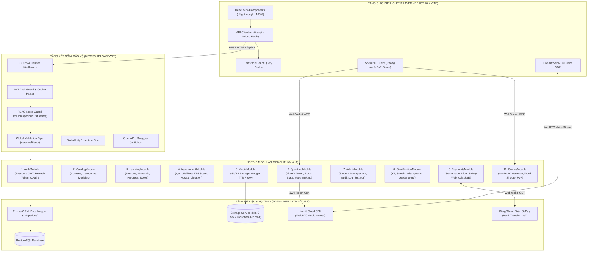
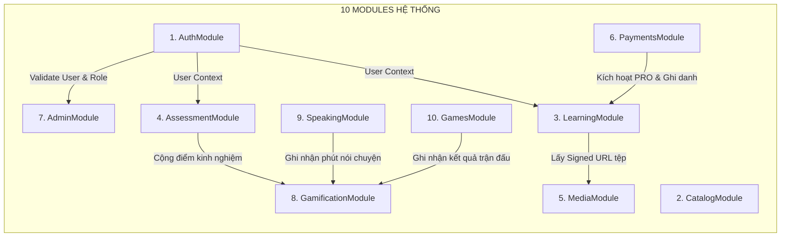
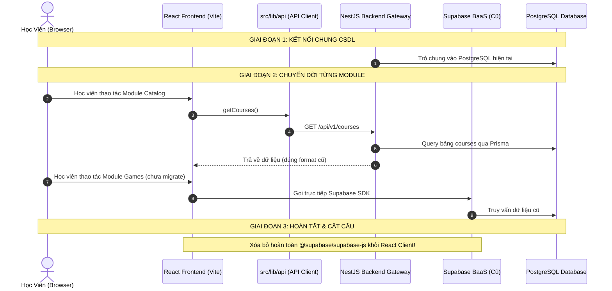

# TÀI LIỆU THIẾT KẾ KIẾN TRÚC MỨC CAO (HIGH LEVEL DESIGN - HLD)
## HỆ THỐNG L-ENGLISH ACADEMY REFACTOR

> **Dự án**: L-English Academy  
> **Kiến trúc mục tiêu**: React (Vite) + NestJS (Modular Monolith) + PostgreSQL  
> **Chiến lược chuyển đổi**: Strangler Fig Pattern (Chuyển đổi từng phần, không downtime)  
> **Tài liệu tham chiếu**: [CURRENT_STATE.md](CURRENT_STATE.md), [AGENTS.md](../AGENTS.md)

---

## 1. Tổng Quan Kiến Trúc

Hệ thống chuyển dịch từ mô hình **BaaS hai tầng** (Frontend React gọi trực tiếp Supabase qua SDK PostgREST) sang mô hình **Backend tập trung ba tầng** (Client -> NestJS Modular Monolith API Gateway & Services -> PostgreSQL Database).

### 1.1. Sơ Đồ Kiến Trúc Tổng Thể



---

## 2. Các Quyết Định Kiến Trúc Cốt Lõi (Key Decisions)

| Hạng mục | Quyết định kỹ thuật | Lý do & Giá trị mang lại |
| :--- | :--- | :--- |
| **Kiểu hình phân tán** | **Modular Monolith** | Toàn bộ codebase backend nằm trong 1 repo NestJS duy nhất, chia module nghiêm ngặt. **Không dùng microservices** để tránh phức tạp hóa hạ tầng, latency mạng và distributed transaction. |
| **Hạ tầng bổ trợ** | **Chưa dùng Redis / Queue** | Lưu lượng hiện tại hoàn toàn xử lý trọn vẹn trong PostgreSQL và in-memory / event emitter của Node.js. Chỉ bổ sung Redis khi tải vượt ngưỡng 5.000 concurrent users. |
| **Xác thực (Auth)** | **Tự xây dựng (Custom Auth)** | - Access Token: JWT thời hạn ngắn (15 phút), gửi qua Authorization Bearer header.<br/>- Refresh Token: Token xoay vòng (rotating), lưu an toàn trong cookie `httpOnly`, `sameSite: 'lax'`, `secure: true`.<br/>- Tích hợp Passport JWT Strategy và Google OAuth2 Strategy. |
| **Phân quyền (RBAC)** | **Guards & Services** | Chuyển toàn bộ 31 RLS policies hiện có của Supabase thành NestJS `@UseGuards(JwtAuthGuard, RolesGuard)` và nghiệp vụ trong Service. Database chỉ mở kết nối cho Backend user. |
| **ORM & CSDL** | **Prisma ORM** | Schema type-safe, migration rõ ràng, code-completion vượt trội, map 1-1 với 31 bảng PostgreSQL hiện hữu. Không sử dụng chế độ `synchronize` trong production. |
| **Giao tiếp Realtime** | **SSE + Socket.IO** | - **Server-Sent Events (SSE)**: Dành riêng cho trạng thái đơn thanh toán (`/api/v1/payments/orders/:code/stream`), nhẹ hơn WebSocket, tự động reconnect.<br/>- **Socket.IO Gateway**: Dành cho phòng luyện nói (danh sách thành viên vào/ra, giơ tay) và Game Word Shooter PvP. |
| **Đàm thoại Voice** | **LiveKit SFU 100%** | **Bỏ hoàn toàn WebRTC mesh P2P** cũ (vốn gây nghẽn băng thông học viên khi phòng > 3 người). Mọi phòng nói đều kết nối qua LiveKit SFU; backend chỉ làm nhiệm vụ cấp JWT LiveKit token. |
| **Lưu trữ tệp (Storage)**| **StorageService Interface** | Thiết kế interface độc lập: môi trường dev dùng Local Storage / MinIO; môi trường production dùng Cloudflare R2 hoặc AWS S3. Trả về signed URL có thời hạn cho video và tài liệu khóa học trả phí. |
| **Dữ liệu tĩnh lớn** | **Nạp vào CSDL** | Chuyển hai file tĩnh nặng trong bundle client ([part2CoachData.ts](../src/data/part2CoachData.ts) - 414KB và [toeic600Data.ts](../src/data/toeic600Data.ts) - 177KB) thành bảng CSDL, giúp giảm 600KB bundle client ban đầu và cho phép cập nhật nội dung không cần build lại frontend. |
| **Chuẩn API** | **REST /api/v1 + OpenAPI** | Tuân thủ RESTful convention, OpenAPI 3.0 với `@nestjs/swagger`, DTO validation tự động qua `class-validator` và `class-transformer`. |

---

## 3. Ranh Giới & Trách Nhiệm Của 10 Module Backend



### Chi tiết nghiệp vụ từng Module:

1. **`AuthModule`**:
   - Quản lý đăng ký, đăng nhập email/mật khẩu, xác nhận email, quên/đặt lại mật khẩu.
   - Google OAuth2 callback.
   - Xoay vòng Refresh Token (Token Rotation) và blacklist token khi logout.
   - Profile cá nhân (`full_name`, `avatar_url`, trạng thái `is_pro`).

2. **`CatalogModule`**:
   - Danh mục khóa học (`course_categories`).
   - Khóa học (`courses`): lọc theo kỹ năng, cấp độ, miễn phí / trả phí.
   - Cây bài học và modules (`modules`, cấu trúc chương hồi).

3. **`LearningModule`**:
   - Bài học (`lessons`): video URL, PDF đính kèm, từ vựng đi kèm.
   - Tiến độ học (`user_lesson_progress`): lưu số giây đã xem, đánh dấu hoàn thành.
   - Ghi chú cá nhân (`user_notes`), danh sách yêu thích (`user_favorites`).
   - Ghi danh khóa học (`enrollments`): kiểm tra quyền truy cập bài học trả phí.

4. **`AssessmentModule` (Trọng tâm bảo mật thi cử)**:
   - **Quiz Engine**: Chấm bài trắc nghiệm hoàn toàn ở server (`POST /quizzes/:id/submit`). Client chỉ gửi `{ questionId, selectedAnswerId }`. Ẩn cột `is_correct` khỏi client.
   - **FullTest Engine**: Chấm đề thi thử 200 câu TOEIC. Quy đổi điểm Listening / Reading theo thang điểm ETS chuẩn quốc tế ở server. Lưu lịch sử nộp bài `user_full_test_results` và chi tiết `full_test_answer_details`.
   - **Vocabulary**: Flashcard, bộ từ vựng theo chủ đề, bài kiểm tra từ vựng.
   - **Dictation**: Luyện nghe chép chính tả, so khớp chuỗi văn bản và tính độ chính xác ở server.

5. **`MediaModule`**:
   - Upload ảnh đại diện, media câu hỏi.
   - Proxy âm thanh Google Translate Text-to-Speech (thay thế `api/tts.ts`).
   - Cấp Signed URL có thời hạn cho video bài giảng trả phí.

6. **`PaymentsModule`**:
   - Tạo đơn thanh toán với giá niêm yết server-side (`POST /payments/create-order`).
   - Webhook tiếp nhận biến động số dư từ SePay 24/7 (`POST /payments/webhook`), kiểm tra bảo mật IP/token.
   - Kích hoạt gói VIP PRO, tự động ghi danh vào tất cả khóa học (`enrollments`) trong 1 Transaction CSDL.
   - Endpoint Server-Sent Events (SSE) để Modal thanh toán cập nhật tức thời khi tiền về.

7. **`AdminModule`**:
   - Quản lý danh sách học viên, kích hoạt/khóa tài khoản, xem lịch sử học tập.
   - Duyệt đơn chuyển khoản thủ công nếu học viên gõ sai cú pháp.
   - Nhật ký hoạt động quản trị (`admin_activity_log`).
   - Cài đặt nền tảng (`platform_settings`).

8. **`GamificationModule`**:
   - Di dời toàn bộ logic từ `localStorage` vào PostgreSQL (`user_gamification`).
   - Tính toán XP khi hoàn thành bài học, quiz, trận thắng game.
   - Daily Streak (chuỗi ngày học liên tục) và cronjob kiểm tra lúc 00:00.
   - Bảng xếp hạng (Leaderboard) tuần / tháng của toàn bộ học viên.

9. **`SpeakingModule`**:
   - Tạo và quản lý phòng luyện nói (`speaking_rooms`).
   - Cấp JWT token kết nối LiveKit SFU Server.
   - Socket.IO thông báo trạng thái phòng, danh sách người trong phòng, đếm thời gian nói chuyện (`speaking_sessions`).

10. **`GamesModule`**:
    - WebSocket Gateway phục vụ game đấu từ vựng (Word Shooter PvP / Solo).
    - Tính điểm, trừ sao, thăng hạng (Đồng -> Chiến Tướng) hoàn toàn ở server, chống gian lận F12.

---

## 4. Chiến Lược Di Chuyển Dần (Strangler Fig Strategy)

Chúng ta không đập đi xây lại toàn bộ một lần (Big Bang), mà áp dụng **Strangler Pattern**:



- **Bước 1**: NestJS backend kết nối trực tiếp vào PostgreSQL hiện tại (được cấu hình qua `SUPABASE_DB_URL`).
- **Bước 2**: Di chuyển từng module theo thứ tự ưu tiên. Mỗi khi xong một module:
  - Frontend chuyển đổi các hooks/services từ gọi Supabase SDK sang gọi qua `src/lib/api`.
  - Component JSX/CSS giữ nguyên 100%, không bị ảnh hưởng.
- **Bước 3**: Sau khi cả 10 module hoàn tất, gỡ bỏ hoàn toàn `@supabase/supabase-js`, thư mục `supabase/` và thư mục `api/`.

---

## 5. Thứ Tự Triển Khai Module (Execution Roadmap)

```
[1. Auth & Users] 
       └──> [2. Catalog] 
                 └──> [3. Learning] 
                           └──> [4. Assessment (Quiz, FullTest, Vocab, Dictation)]
                                     └──> [5. Media] 
                                               └──> [6. Payments & SePay] 
                                                         └──> [7. Admin] 
                                                                   └──> [8. Gamification] 
                                                                             └──> [9. Speaking Rooms] 
                                                                                       └──> [10. Games Hub]
```

1. **Module 1 - Auth**: Nền móng cho toàn bộ hệ thống (JWT, Refresh Token, Profile, Role Guards).
2. **Module 2 - Catalog**: Khóa học, danh mục, cấu trúc module (Dữ liệu đọc nhiều, ít phức tạp).
3. **Module 3 - Learning**: Bài học, tài liệu, tiến độ học, ghi chú, kiểm tra quyền truy cập.
4. **Module 4 - Assessment**: Chấm bài quiz, chấm đề thi thử Full Test 200 câu TOEIC theo thang điểm ETS chuẩn ở server, từ vựng, nghe chép chính tả.
5. **Module 5 - Media**: Quản lý upload media, signed URL video, TTS audio.
6. **Module 6 - Payments**: Đơn thanh toán, webhook SePay, SSE stream trạng thái đơn, nâng VIP PRO.
7. **Module 7 - Admin**: Quản trị học viên, duyệt đơn, log kiểm toán, cấu hình nền tảng.
8. **Module 8 - Gamification**: Bảng xếp hạng, lưu XP, streak, nhiệm vụ hàng ngày.
9. **Module 9 - Speaking**: Phòng luyện nói, LiveKit JWT token, WebSockets thành viên phòng.
10. **Module 10 - Games**: WebSocket Gateway game Word Shooter, bảng xếp hạng rank thời gian thực.
